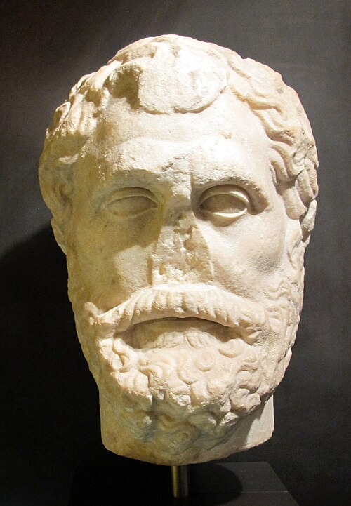

# Thales

**Born:** c. 624 BCE

**Died / status:** c. 547 BCE

**Fields:** Natural philosophy, History of magnetism

A later painting, sculpture or traditional representation; it is not a verified contemporary likeness.

## Biography

A thinker from Miletus in ancient Ionia, Thales was later remembered as an early exponent of explanations based on nature rather than myth. Most accounts of his life were written much later; stories such as his prediction of an eclipse remain disputed. He is included here as a precursor of natural philosophy.

## Major contributions to physics

- Sought a common natural principle with which to explain the world.
- Later writers credited him with observations of magnets attracting iron, an early episode in the history of magnetism.

## Historical and source notes

- His life and attributed discoveries are known mainly from later testimony; the birth and death years are estimates.
- He is included as a precursor of natural philosophy; ancient explanations must not be equated with modern experimental theories.

## Image source and rights

- Source: [Original image record](https://commons.wikimedia.org/wiki/File:Arte_romana,_testa_di_talete_di_mileto,_II_sec..JPG)
- Creator / attribution: Sailko
- License or rights statement: [CC BY-SA 3.0](https://creativecommons.org/licenses/by-sa/3.0)
- Local image: [f71f1e515442d99100d7.jpg](../portraits/f71f1e515442d99100d7.jpg)
- Credit: Own work

## Sources

- [MacTutor History of Mathematics — Thales](https://mathshistory.st-andrews.ac.uk/Biographies/Thales/)
- [Wikipedia — Thales](https://en.wikipedia.org/wiki/Thales)

Record reviewed: 2026-10-26.
