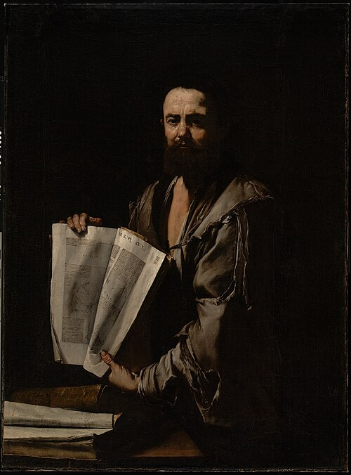

# Euclid

**Born:** c. 325 BCE

**Died / status:** c. 265 BCE

**Fields:** Geometrical optics, Mathematical physics

A later painting, sculpture or traditional representation; it is not a verified contemporary likeness.

## Biography

Euclid was a mathematician active in ancient Alexandria whose life is poorly documented. His Elements supplied a lasting language of geometrical proof for physical theories. His Optics organized questions about vision and perspective into geometrical propositions and belongs to the ancient tradition of mathematical approaches to nature.

## Major contributions to physics

- Organized geometry into an axiomatic, deductive system used in mechanics, astronomy and optics.
- Used geometry in the Optics to investigate visual angles, lines of sight and apparent size.

## Historical and source notes

- Biographical evidence is extremely limited, and reconstructions of his approximate dates differ.

## Image source and rights

- Source: [Original image record](https://commons.wikimedia.org/wiki/File:Italian_-_Euclid_-_Google_Art_Project.jpg)
- Creator / attribution: Jusepe de Ribera (Spanish / Italian, 1591 - 1652) (1591 - 1652) – artist (Spanish / Italian) Details on Google Art Project
- License or rights statement: Public domain
- Local image: [120bf6896dd33173fd22.jpg](../portraits/120bf6896dd33173fd22.jpg)
- Credit: wAGVeSb2M1HfDA at Google Cultural Institute maximum zoom level

## Sources

- [MacTutor History of Mathematics — Euclid](https://mathshistory.st-andrews.ac.uk/Biographies/Euclid/)
- [Wikipedia — Euclid](https://en.wikipedia.org/wiki/Euclid)

Record reviewed: 2026-10-26.
