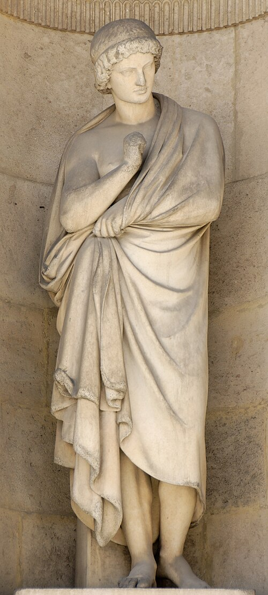

# Aristarchus of Samos

**Born:** c. 310 BCE

**Died / status:** c. 230 BCE

**Fields:** Astronomy, History of cosmology

A later painting, sculpture or traditional representation; it is not a verified contemporary likeness.

## Biography

An ancient Greek astronomer from Samos, Aristarchus attempted to estimate the relative sizes and distances of the Sun and Moon geometrically. He also proposed a Sun-centred system in which Earth moves around the Sun. This cosmological proposal is known principally through the testimony of Archimedes and other writers.

## Major contributions to physics

- Proposed an ancient heliocentric model that used Earth's motion to explain celestial phenomena.
- Used lunar phases and angular relationships to estimate relative celestial distances and sizes.

## Image source and rights

- Source: [Original image record](https://commons.wikimedia.org/wiki/File:Aristarchus_Diebolt_Merley_cour_Carree_Louvre.jpg)
- Creator / attribution: See the original image record
- License or rights statement: [CC BY 2.5](https://creativecommons.org/licenses/by/2.5/)
- Local image: [90f12973f86b794abbbc-6921ae3c05.jpg](../portraits/90f12973f86b794abbbc-6921ae3c05.jpg)
- Credit: Jastrow (Own work)

## Sources

- [MacTutor History of Mathematics — Aristarchus of Samos](https://mathshistory.st-andrews.ac.uk/Biographies/Aristarchus/)
- [Wikipedia — Aristarchus of Samos](https://en.wikipedia.org/wiki/Aristarchus_of_Samos)

Record reviewed: 2026-10-26.
