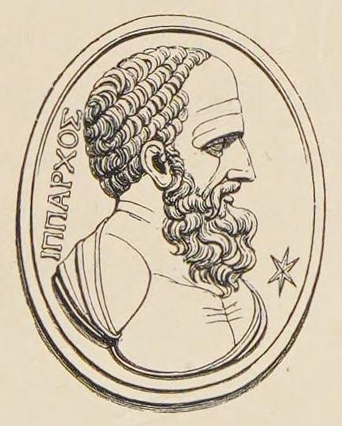

# Hipparchus

**Born:** c. 190 BCE

**Died / status:** c. 120 BCE

**Fields:** Astrometry, History of celestial mechanics

A later painting, sculpture or traditional representation; it is not a verified contemporary likeness.

## Biography

Hipparchus was an ancient Greek astronomer associated with Nicaea and Rhodes. He assembled observations and developed quantitative models of solar and lunar motion. Most of his works are lost, but results preserved by Ptolemy and other authors became important foundations for positional astronomy.

## Major contributions to physics

- Recognized the precession of the equinoxes by comparing stellar positions from different periods.
- Developed trigonometric computation and models that improved quantitative descriptions of celestial positions and periods.

## Image source and rights

- Source: [Original image record](https://commons.wikimedia.org/wiki/File:Head_of_Hipparchus_(cropped).jpg)
- Creator / attribution: William Henry Smyth
- License or rights statement: Public domain
- Local image: [88a989586786b412fe93.jpg](../portraits/88a989586786b412fe93.jpg)
- Credit: George F. Chambers, A Handbook of Descriptive and Practical Astronomy, Vol. 3 (4th ed.) https://archive.org/details/handbookofdescri0003geor/page/n10/mode/1up

## Sources

- [MacTutor History of Mathematics — Hipparchus](https://mathshistory.st-andrews.ac.uk/Biographies/Hipparchus/)
- [Wikipedia — Hipparchus](https://en.wikipedia.org/wiki/Hipparchus)

Record reviewed: 2026-10-26.
