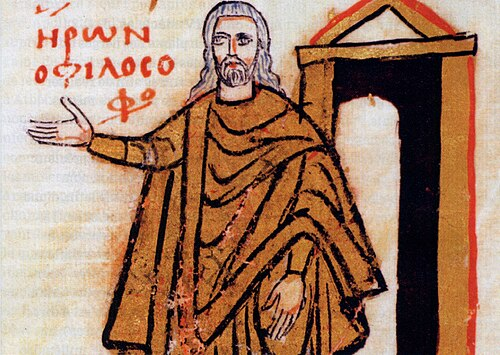

# Hero of Alexandria

**Born:** c. 10 CE

**Died / status:** c. 75 CE

**Fields:** Mechanics, Pneumatics, History of engineering physics

A later painting, sculpture or traditional representation; it is not a verified contemporary likeness.

## Biography

Hero, or Heron, was a mathematical and engineering author of ancient Alexandria whose exact dates remain disputed. His writings assembled and developed knowledge of pneumatics, automata, surveying and mechanics, linking Greek mathematical traditions to later engineering practice. The dates in this archive are conventional estimates.

## Major contributions to physics

- Described devices operated by air, steam and liquid pressure in the Pneumatica.
- Recorded the aeolipile, a reaction-driven rotating device, and discussed mechanisms, equilibrium and measurement.

## Historical and source notes

- His period of activity and life dates are disputed; approximately 10–75 CE follows MacTutor and is not an exact lifespan.

## Image source and rights

- Source: [Original image record](https://commons.wikimedia.org/wiki/File:Heron_Alexandrie.jpg)
- Creator / attribution: Unknown author
- License or rights statement: Public domain
- Local image: [b31e9239eb7a066d7ffa.jpg](../portraits/b31e9239eb7a066d7ffa.jpg)
- Credit: Historia n° 767 - Novembre 2010 - page

## Sources

- [MacTutor History of Mathematics — Hero of Alexandria](https://mathshistory.st-andrews.ac.uk/Biographies/Heron/)
- [Wikipedia — Hero of Alexandria](https://en.wikipedia.org/wiki/Hero_of_Alexandria)

Record reviewed: 2026-10-26.
