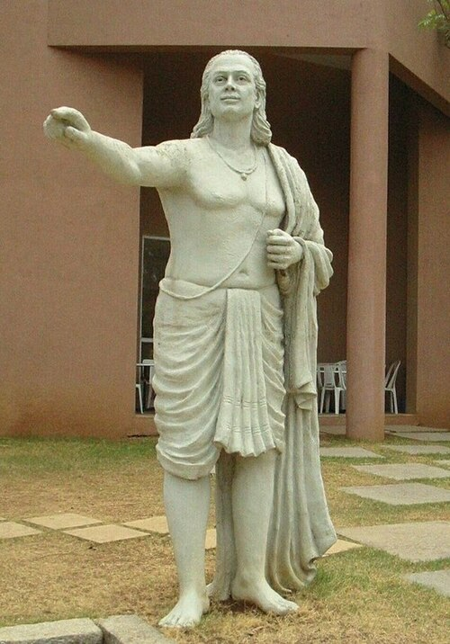

# Aryabhata

**Born:** 476 CE

**Died / status:** c. 550 CE

**Fields:** Mathematical astronomy, Earth's motion

The creator, date and form of the image are documented at its source; later representations are not verified contemporary likenesses.

## Biography

Aryabhata was an Indian mathematician and astronomer best known for the Aryabhatiya, written in 499. His birthplace is disputed. He applied mathematical computation to celestial periods, eclipses and Earth's motion and became a major figure in Indian mathematical astronomy. His exact death date is unknown.

## Major contributions to physics

- Explained the apparent daily motion of the stars through Earth's rotation.
- Explained eclipses through the shadows of Earth and Moon and developed computational methods for celestial positions.

## Historical and source notes

- The birth year is inferred mainly from an age statement in his work; 550 is a conventional approximate death year, not an established exact date.

## Image source and rights

- Source: [Original image record](https://commons.wikimedia.org/wiki/File:Aryabhatta_of_Bihar.jpg)
- Creator / attribution: Cpjha13
- License or rights statement: [CC BY-SA 4.0](https://creativecommons.org/licenses/by-sa/4.0)
- Local image: [8abe5f100b35a1a3f1a7-3e4f3f1007.jpg](../portraits/8abe5f100b35a1a3f1a7-3e4f3f1007.jpg)
- Credit: Own work

## Sources

- [MacTutor History of Mathematics — Aryabhata](https://mathshistory.st-andrews.ac.uk/Biographies/Aryabhata_I/)
- [Wikipedia — Aryabhata](https://en.wikipedia.org/wiki/Aryabhata)

Record reviewed: 2026-10-26.
