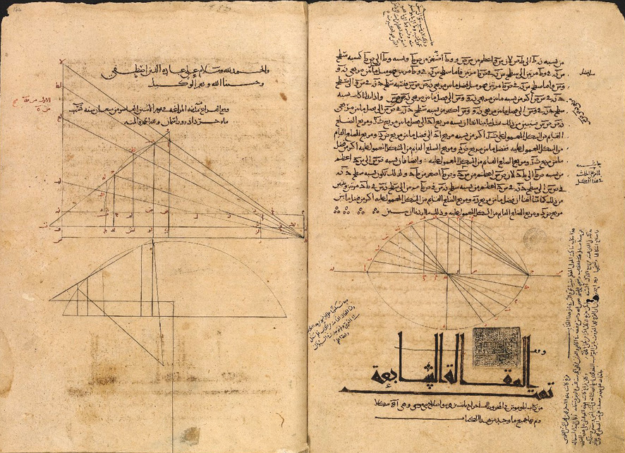

# Thabit ibn Qurra

**Born:** c. 826–836 CE

**Died / status:** 18 February 901 CE

**Fields:** Statics, Mathematical astronomy

No verified portrait was obtained. These pages are from a 1070 Arabic manuscript of Apollonius’s Conics (Bodleian Libraries, MS. Marsh 667, fols. 162b and 164a), associated with the translation and revision tradition in which Thābit participated. They are neither his autograph nor a portrait.

## Biography

Thabit ibn Qurra was a Sabian mathematician, astronomer and translator from Harran who later worked in Baghdad. He translated and reworked Greek mathematical and scientific texts and connected astronomy, geometry and statics. Sources differ on his birth year, commonly giving approximately 826 or 836.

## Major contributions to physics

- Investigated levers, equilibrium and centres of gravity, developing statics in Arabic mathematical scholarship.
- Studied celestial motion, the length of the solar year and geometrical methods in astronomy.

## Historical and source notes

- Sources give birth around 826 or 836; no exact day is established, and the interval is retained.

## Image source and rights

- Source: [Original image record](https://commons.wikimedia.org/wiki/File:Conica_of_Apollonius_of_Perga_fol._162b_and_164a.jpg)
- Creator / attribution: Bodleian Libraries, University of Oxford
- License or rights statement: [CC BY 4.0](https://creativecommons.org/licenses/by/4.0/)
- Local image: [23d942283953cb611667-2a84f1cb5b.jpg](../portraits/23d942283953cb611667-2a84f1cb5b.jpg)
- Credit: Bodleian Libraries, University of Oxford

## Sources

- [MacTutor History of Mathematics — Thabit ibn Qurra](https://mathshistory.st-andrews.ac.uk/Biographies/Thabit/)
- [Wikipedia — Thabit ibn Qurra](https://en.wikipedia.org/wiki/Th%C4%81bit_ibn_Qurra)

Record reviewed: 2026-10-26.
