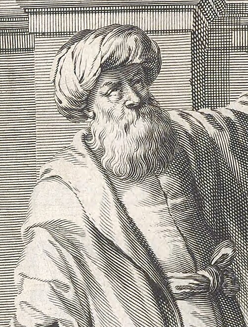

# Ibn al-Haytham

**Born:** c. 965 CE

**Died / status:** c. 1040

**Fields:** Optics, History of experimental methods

A later painting, sculpture or traditional representation; it is not a verified contemporary likeness.

## Biography

Ibn al-Haytham was a mathematician and optical investigator of the Islamic Golden Age, born in or near Basra and later active mainly in Cairo. His Book of Optics combined geometrical analysis, studies of vision and experimental reasoning. Its Latin transmission strongly influenced medieval and early modern European optics.

## Major contributions to physics

- Explained vision through light entering the eye and systematically criticized theories of rays emitted by the eye.
- Investigated reflection, refraction, the camera obscura and image formation through experiments and geometry.

## Historical and source notes

- The life dates are approximate; some accounts place his death around 1039 or after 1040.

## Image source and rights

- Source: [Original image record](https://commons.wikimedia.org/wiki/File:Ibn_al-Haytham_crop.jpg)
- Creator / attribution: Adolph Boÿ, engraved by Jeremias Falck. Used as the frontispiece to Johannes Hevelius, Selenographia, 1647
- License or rights statement: Public domain
- Local image: [694e31f896871d393be5.jpg](../portraits/694e31f896871d393be5.jpg)
- Credit: https://www.loc.gov/resource/rbctos.2017rosen1321/?sp=9&r=0.059,0.617,0.327,0.182,0

## Sources

- [MacTutor History of Mathematics — Ibn al-Haytham](https://mathshistory.st-andrews.ac.uk/Biographies/Al-Haytham/)
- [Wikipedia — Ibn al-Haytham](https://en.wikipedia.org/wiki/Ibn_al-Haytham)

Record reviewed: 2026-10-26.
