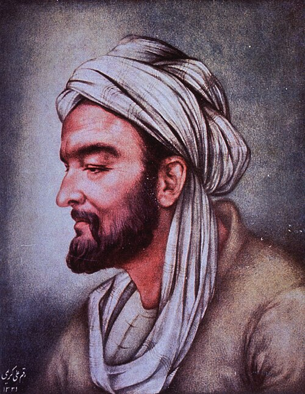

# Avicenna

**Born:** c. 980 CE

**Died / status:** June 1037

**Fields:** History of theories of motion, Natural philosophy

The creator, date and form of the image are documented at its source; later representations are not verified contemporary likenesses.

## Biography

Avicenna, or Ibn Sina, was a medieval philosopher, physician and natural investigator active in Central Asia and Iran. Encyclopedic works such as the Book of Healing treated motion, time, media and celestial bodies. His system strongly influenced subsequent Arabic and Latin scholastic traditions.

## Major contributions to physics

- Used the concept of inclination in accounts of forced and projectile motion within an Aristotelian framework.
- Systematically discussed physical bodies, time, space and celestial motion, shaping medieval natural philosophy.

## Historical and source notes

- Birth year and death month follow conventional historical dating; exact converted days are not treated as undisputed.

## Image source and rights

- Source: [Original image record](https://commons.wikimedia.org/wiki/File:Avicenna_Bust,_left_profile_(cropped).jpg)
- Creator / attribution: National Library of Medicine
- License or rights statement: [No restrictions](https://www.flickr.com/commons/usage/)
- Local image: [eaa6ba2a43b911cf601c-ae44d0f053.jpg](../portraits/eaa6ba2a43b911cf601c-ae44d0f053.jpg)
- Credit: https://www.flickr.com/photos/nlmhmd/54093321223/

## Sources

- [MacTutor History of Mathematics — Avicenna](https://mathshistory.st-andrews.ac.uk/Biographies/Avicenna/)
- [Wikipedia — Avicenna](https://en.wikipedia.org/wiki/Avicenna)

Record reviewed: 2026-10-26.
