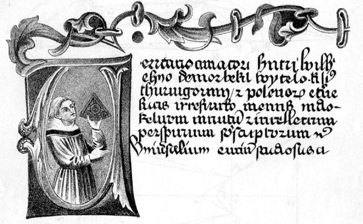

# Witelo

**Born:** c. 1230

**Died / status:** after 1280; exact year unknown

**Fields:** Geometrical optics, History of vision science

An author miniature and text from a manuscript of Perspectiva, dated in the image record to the late thirteenth century. The medieval author miniature is not a verified record of Witelo’s actual appearance; it is presented as a work image.

## Biography

Witelo was a thirteenth-century scholar active in Silesia and Italy whose exact dates and parts of his life are disputed. His ten-book Perspectiva organized knowledge of vision, reflection and refraction, transmitting Ibn al-Haytham's research to Latin scholarship and later influencing Kepler's optics.

## Major contributions to physics

- Systematized geometrical treatments of reflection, refraction and vision.
- Transmitted Arabic optical research through the Latin Perspectiva, providing important material for later studies of vision and imaging.

## Historical and source notes

- His dates are substantially uncertain: birth around 1230 and death after 1280, with some reconstructions placing death around 1314.

## Image source and rights

- Source: [Original image record](https://commons.wikimedia.org/wiki/File:Witelo-Perspectiva.jpg)
- Creator / attribution: Unknown medieval artist
- License or rights statement: [Public domain, as recorded by Wikimedia Commons](https://creativecommons.org/publicdomain/mark/1.0/)
- Local image: [812e0a5d0317add6b48e-2c913e771d.jpg](../portraits/812e0a5d0317add6b48e-2c913e771d.jpg)
- Credit: Unknown medieval artist

## Sources

- [Columbia University, Chaucer Name Dictionary — Vitulon (Witelo)](http://www.columbia.edu/dlc/garland/deweever/UV/vitulon.htm)
- [Wikipedia — Witelo](https://en.wikipedia.org/wiki/Witelo)

Record reviewed: 2026-10-26.
