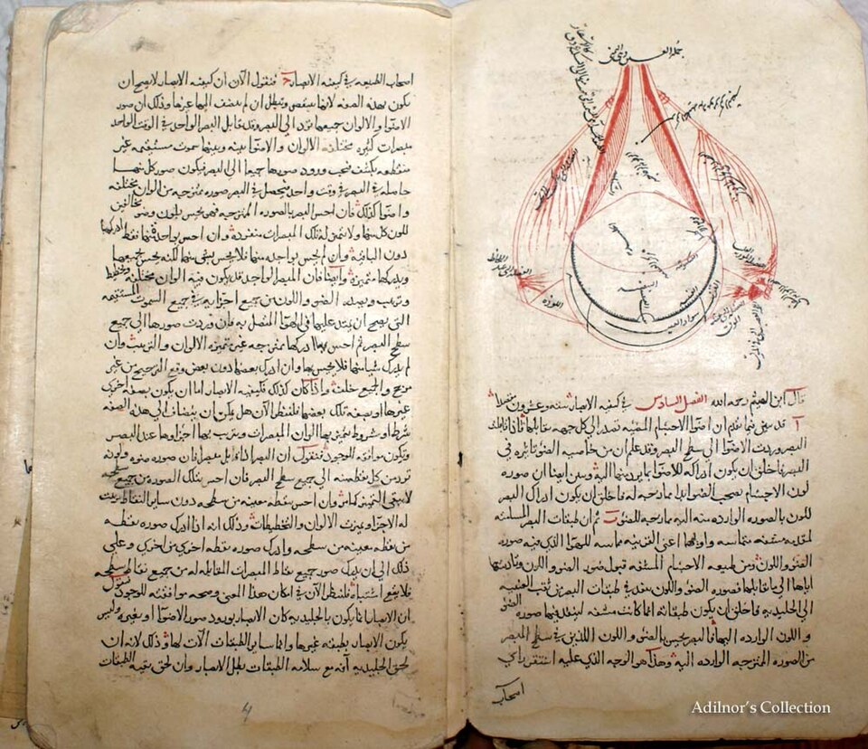

# Kamal al-Din al-Farisi

**Born:** c. 1260–1267

**Died / status:** c. 1319–1320

**Fields:** Geometrical optics, Physics of the rainbow

A manuscript page of al-Fārisī’s Revision of Optics, described in the source record as an autograph dated 1309, in the Adilnor Collection. It shows optical text and diagrams, not a portrait.

## Biography

Al-Farisi was a medieval Iranian mathematician and optical scholar who studied under Qutb al-Din al-Shirazi. In a revision of Ibn al-Haytham's Optics, he developed experimental and geometrical analysis and used transparent spheres as models of raindrops. Biographical sources differ on his dates.

## Major contributions to physics

- Explained primary and secondary rainbows through refraction and internal reflection in spherical water drops.
- Extended Ibn al-Haytham's optical tradition through experimental models and geometrical analysis.

## Historical and source notes

- Birth has been placed around 1260, 1265 or 1267, and death in 1319 or around 1320; approximate ranges and source differences are retained.

## Image source and rights

- Source: [Original image record](https://commons.wikimedia.org/wiki/File:Kamal-1.jpg)
- Creator / attribution: Adilnor Collection
- License or rights statement: [CC BY-SA 3.0; attribution: Adilnor Collection](https://creativecommons.org/licenses/by-sa/3.0/)
- Local image: [b06dd7fa1c1de26d5216-84e53c35b0.jpg](../portraits/b06dd7fa1c1de26d5216-84e53c35b0.jpg)
- Credit: Adilnor Collection

## Sources

- [MacTutor History of Mathematics — Kamal al-Din al-Farisi](https://mathshistory.st-andrews.ac.uk/Biographies/Al-Farisi/)
- [Wikipedia — Kamal al-Din al-Farisi](https://en.wikipedia.org/wiki/Kamal_al-Din_al-Farisi)

Record reviewed: 2026-10-26.
