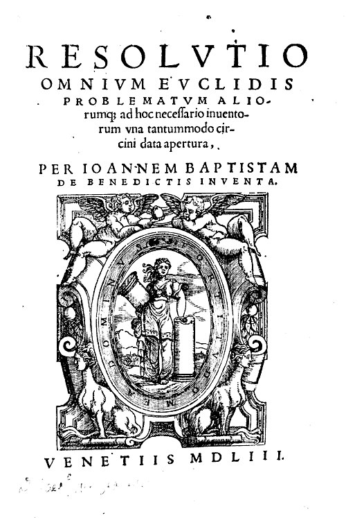

# Giovanni Battista Benedetti

**Born:** 14 August 1530

**Died / status:** 20 January 1590

**Fields:** History of kinematics, Statics

The title page of Benedetti’s 1553 work. No usable reliably identified portrait was obtained; this document illustration is not a portrait.

## Biography

Benedetti was an Italian mathematician and court scholar who worked in Parma and Turin. He investigated falling bodies, statics and geometry and criticized Aristotelian explanations of falling speed. His arguments are important evidence for changes in theories of motion before Galileo.

## Major contributions to physics

- Rejected the simple proportionality of falling speed to weight and emphasized the role of resistance from the medium.
- Applied statics and geometrical reasoning to problems of motion and mechanical equilibrium.

## Image source and rights

- Source: [Original image record](https://commons.wikimedia.org/wiki/File:Benedetti_-_Resolutio_omnium_Euclidis_problematum,_1553_-_11183.jpg)
- Creator / attribution: Benedetti, Giovanni Battista
- License or rights statement: [Public domain](https://creativecommons.org/publicdomain/mark/1.0/)
- Local image: [9a3284e5974b5e80e817-dd7f2b44ae.jpg](../portraits/9a3284e5974b5e80e817-dd7f2b44ae.jpg)
- Credit: Available in the BEIC digital library and uploaded in partnership with BEIC Foundation.

## Sources

- [MacTutor History of Mathematics — Giovanni Battista Benedetti](https://mathshistory.st-andrews.ac.uk/Biographies/Benedetti/)
- [Wikipedia — Giovanni Battista Benedetti](https://en.wikipedia.org/wiki/Giovanni_Battista_Benedetti)

Record reviewed: 2026-10-26.
