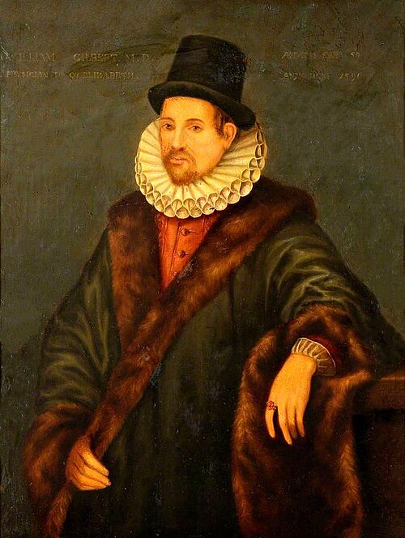

# William Gilbert

**Born:** 1544

**Died / status:** 1603

**Fields:** Magnetism, Electrostatics

The creator, date and form of this likeness are documented at the image source.

## Biography

William Gilbert was an English physician and natural investigator who served as a royal doctor. His De magnete of 1600 distinguished magnetism from frictional electrification through extensive experiments. Using a spherical lodestone as a model of Earth, he became a central figure in the development of experimental magnetism.

## Major contributions to physics

- Proposed treating Earth as a large magnet to explain compass direction and magnetic inclination.
- Systematically investigated lodestones and frictional electrification and distinguished electrical from magnetic effects.

## Image source and rights

- Source: [Original image record](https://commons.wikimedia.org/wiki/File:William_Gilbert_45626i.jpg)
- Creator / attribution: Unknown author
- License or rights statement: Public domain
- Local image: [ca9ad47765da041bf027.jpg](../portraits/ca9ad47765da041bf027.jpg)
- Credit: Wellcome Library, Accession number: 45626i

## Sources

- [Museo Galileo — William Gilbert](https://catalogue.museogalileo.it/biography/WilliamGilbert.html)
- [Wikipedia — William Gilbert (physicist)](https://en.wikipedia.org/wiki/William_Gilbert_(physicist))

Record reviewed: 2026-10-26.
