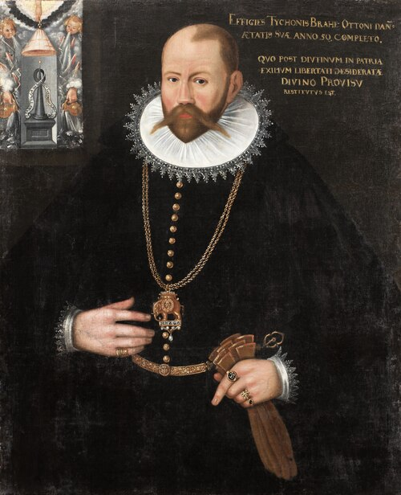

# Tycho Brahe

**Born:** 14 December 1546

**Died / status:** 24 October 1601

**Fields:** Astrometry, History of cosmology

The creator, date and form of this likeness are documented at the image source.

## Biography

Tycho Brahe was a Danish astronomer who established observatories on the island of Hven and later worked in Prague. Before the telescope, he used large precision instruments to accumulate systematic celestial positions. His planetary observations, especially of Mars, were crucial evidence for Kepler's laws.

## Major contributions to physics

- Greatly improved the accuracy and continuity of naked-eye measurements of celestial positions.
- Used observations of a new star and comets to challenge the traditional view of an unchanging celestial realm.

## Image source and rights

- Source: [Original image record](https://commons.wikimedia.org/wiki/File:Portr%C3%A4tt_av_Tycho_Brahe_-_Skoklosters_slott_-_90153.tif)
- Creator / attribution: Unknown author
- License or rights statement: [Public domain](https://freedomdefined.org/Definition)
- Local image: [1676f5d7d924d677cd2c.jpg](../portraits/1676f5d7d924d677cd2c.jpg)
- Credit: LSH 90153 (sm_dig3678)

## Sources

- [MacTutor History of Mathematics — Tycho Brahe](https://mathshistory.st-andrews.ac.uk/Biographies/Brahe/)
- [Wikipedia — Tycho Brahe](https://en.wikipedia.org/wiki/Tycho_Brahe)

Record reviewed: 2026-10-26.
