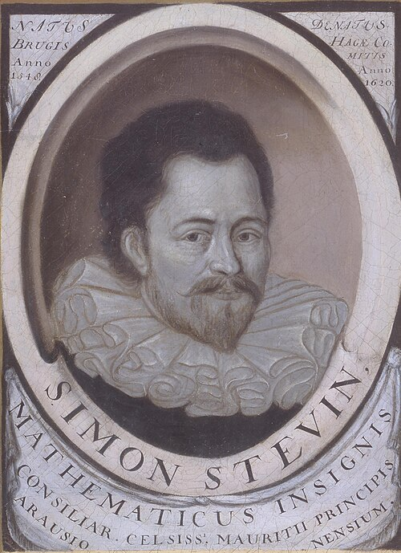

# Simon Stevin

**Born:** 1548

**Died / status:** 1620

**Fields:** Statics, Hydrostatics

The creator, date and form of this likeness are documented at the image source.

## Biography

Simon Stevin was a Flemish mathematician and engineer who later worked in the Dutch Republic on engineering and military technology. He applied mathematics to practical problems and wrote on statics, hydrostatics, surveying and decimal fractions, emphasizing calculable relationships in mechanical phenomena.

## Major contributions to physics

- Developed statics and the composition of forces through arguments about inclined planes and equilibrium.
- Explained the dependence of fluid pressure on depth and investigated the hydrostatic paradox.

## Image source and rights

- Source: [Original image record](https://commons.wikimedia.org/wiki/File:Simon-stevin.jpeg)
- Creator / attribution: Unknown author
- License or rights statement: [Public domain](https://commons.wikimedia.org/wiki/Commons:Reuse_of_PD-Art_photographs)
- Local image: [59c9487f386fa6116977.jpeg](../portraits/59c9487f386fa6116977.jpeg)
- Credit: Digitool Leiden University Library, http://digitalcollections.universiteitleiden.nl

## Sources

- [MacTutor History of Mathematics — Simon Stevin](https://mathshistory.st-andrews.ac.uk/Biographies/Stevin/)
- [Wikipedia — Simon Stevin](https://en.wikipedia.org/wiki/Simon_Stevin)

Record reviewed: 2026-10-26.
