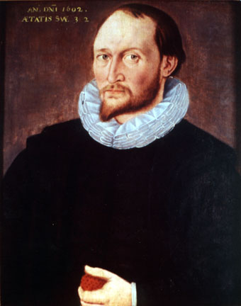

# Thomas Harriot

**Born:** c. 1560

**Died / status:** 2 July 1621

**Fields:** Geometrical optics, Observational astronomy, Ballistics

This is a related historical document, not a portrait of the subject. A 1602 painting traditionally associated with Harriot, but the sitter is unverified. Its inscription gives an age of 32, inconsistent with his birth around 1560. Retained as a disputed historical illustration, not an authenticated portrait of Harriot.

## Biography

Harriot was an English mathematician, astronomer and investigator of navigation who served Raleigh and the Earl of Northumberland and joined a colonial expedition to North America. He studied refraction, ballistics and celestial objects, leaving extensive unpublished manuscripts. His telescopic lunar sketches predated Galileo's published lunar observations.

## Major contributions to physics

- Independently obtained the sine relation for refraction but did not publish it during his lifetime.
- Made early telescopic observations of the Moon and sunspots and applied mathematics to ballistics and navigation.

## Historical and source notes

- Birth around 1560 is inferred from records such as his age at matriculation; no exact day is established. Much optical and astronomical work was not formally published in his lifetime.

## Image source and rights

- Source: [Original image record](https://commons.wikimedia.org/wiki/File:ThomasHarriot.jpg)
- Creator / attribution: Unidentified painter
- License or rights statement: Public domain
- Local image: [338f283904c21856fea0-8a76965e9b.jpg](../portraits/338f283904c21856fea0-8a76965e9b.jpg)
- Credit: http://www.ecu.edu/cs-cas/images/harriot.jpg

## Sources

- [MacTutor History of Mathematics — Thomas Harriot](https://mathshistory.st-andrews.ac.uk/Biographies/Harriot/)
- [Wikipedia — Thomas Harriot](https://en.wikipedia.org/wiki/Thomas_Harriot)

Record reviewed: 2026-10-26.
