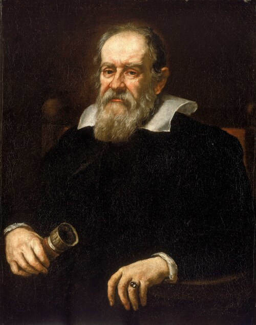

# Galileo Galilei

**Born:** 15 February 1564

**Died / status:** 8 January 1642

**Fields:** Classical mechanics, Astronomy, Experimental methods

The creator, date and form of this likeness are documented at the image source.

## Biography

Galileo taught in Pisa and Padua before serving the Tuscan court. He combined measurement and mathematical reasoning in studies of motion and used improved telescopes to observe the sky. Tried for supporting Earth's motion, he nevertheless completed major work on mechanics in his later years.

## Major contributions to physics

- Established quantitative relationships for falling bodies and uniformly accelerated motion and investigated projectile trajectories.
- Advanced mechanics through discussions of inertia and relative motion.
- Observed Jupiter's satellites and the phases of Venus, providing important evidence for a changed view of the heavens.

## Image source and rights

- Source: [Original image record](https://commons.wikimedia.org/wiki/File:Galileo_Galilei_(1564-1642)_RMG_BHC2700.tiff)
- Creator / attribution: Justus Sustermans
- License or rights statement: Public domain
- Local image: [d0c86e1bdc19c35849d0.jpg](../portraits/d0c86e1bdc19c35849d0.jpg)
- Credit: http://collections.rmg.co.uk/collections/objects/14174

## Sources

- [MacTutor History of Mathematics — Galileo Galilei](https://mathshistory.st-andrews.ac.uk/Biographies/Galileo/)
- [Wikipedia — Galileo Galilei](https://en.wikipedia.org/wiki/Galileo_Galilei)

Record reviewed: 2026-10-26.
