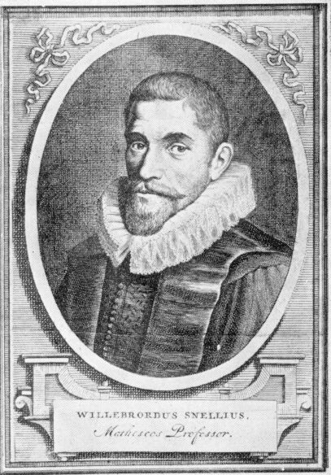

# Willebrord Snellius

**Born:** 13 June 1580

**Died / status:** 30 October 1626

**Fields:** Geometrical optics, Geodesy

The creator, date and form of this likeness are documented at the image source.

## Biography

Snellius was a Dutch mathematician, astronomer and professor at Leiden who investigated geodesy and optics. He used triangulation to estimate Earth's dimensions and independently obtained the sine relation for refraction in the early seventeenth century. His optical result was not formally published during his lifetime.

## Major contributions to physics

- Independently obtained the sine relation for light refracted between different media.
- Advanced triangulation as a method for measuring Earth's dimensions, linking mathematics to precision surveying.

## Image source and rights

- Source: [Original image record](https://commons.wikimedia.org/wiki/File:Willebrord_Snellius.jpg)
- Creator / attribution: See the original image record
- License or rights statement: Public domain
- Local image: [be3cd7f815c13cf7d06a.jpg](../portraits/be3cd7f815c13cf7d06a.jpg)
- Credit: [1] [2]

## Sources

- [MacTutor History of Mathematics — Willebrord Snellius](https://mathshistory.st-andrews.ac.uk/Biographies/Snell/)
- [Wikipedia — Willebrord Snellius](https://en.wikipedia.org/wiki/Willebrord_Snellius)

Record reviewed: 2026-10-26.
