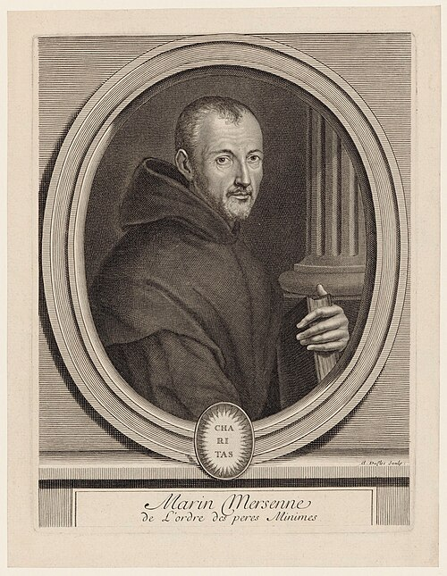

# Marin Mersenne

**Born:** 8 September 1588

**Died / status:** 1 September 1648

**Fields:** Acoustics, Vibrations

A later engraving of Mersenne by Claude Duflos (1665–1727), who was born after Mersenne’s death in 1648; this is a posthumous depiction.

## Biography

Mersenne was a French friar, mathematician and natural investigator who maintained a major correspondence network in Paris, connecting Galileo, Descartes and other European scholars. He studied sound, vibrations and instruments and turned musical questions into measurable physical problems through experiments and books.

## Major contributions to physics

- Investigated the dependence of a stretched string's frequency on its length, tension and linear density.
- Performed experiments on sound speed and vibration and advanced quantitative acoustics in works including Harmonie universelle.

## Image source and rights

- Source: [Original image record](https://commons.wikimedia.org/wiki/File:MarinMersenneDuflos.jpg)
- Creator / attribution: Claude Duflos
- License or rights statement: Public domain
- Local image: [012d0d64cd49d6d25d87-6f598ce077.jpg](../portraits/012d0d64cd49d6d25d87-6f598ce077.jpg)
- Credit: This file comes from Gallica Digital Library and is available under the digital ID btv1b8422568j/f1.zoom

## Sources

- [MacTutor History of Mathematics — Marin Mersenne](https://mathshistory.st-andrews.ac.uk/Biographies/Mersenne/)
- [Wikipedia — Marin Mersenne](https://en.wikipedia.org/wiki/Marin_Mersenne)

Record reviewed: 2026-10-26.
