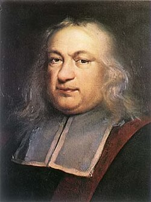

# Pierre de Fermat

**Born:** c. 1601 or 1607 (disputed)

**Died / status:** 12 January 1665

**Fields:** Geometrical optics, Variational principles

The creator, date and form of this likeness are documented at the image source.

## Biography

Fermat was a French magistrate and mathematician based in the Toulouse region who corresponded with European scholars in his spare time. Beyond number theory and analytic methods, he investigated light propagation and introduced a travel-time principle, an important precedent for variational reasoning in physics.

## Major contributions to physics

- Proposed the travel-time principle now associated with stationary optical paths, often called the principle of least time.
- Used this principle to explain reflection and refraction, providing a foundation for later variational optics.

## Historical and source notes

- His birth has been assigned to 1601 and 1607 in different historical studies; 17 August 1601 is not treated as certain.
- The modern principle requires stationary travel time or optical path. It is a minimum in many familiar cases, but not necessarily a global minimum for every ray path.

## Image source and rights

- Source: [Original image record](https://commons.wikimedia.org/wiki/File:Pierre_de_Fermat.jpg)
- Creator / attribution: Unknown author
- License or rights statement: [Public domain](https://commons.wikimedia.org/wiki/File:Pierre_de_Fermat.jpg)
- Local image: [0d795b0af8af9dd4699b.jpg](../portraits/0d795b0af8af9dd4699b.jpg)
- Credit: https://web.archive.org/web/20191028044928/http://www-groups.dcs.st-and.ac.uk/~history/PictDisplay/Fermat.html

## Sources

- [MacTutor History of Mathematics — Pierre de Fermat](https://mathshistory.st-andrews.ac.uk/Biographies/Fermat/)
- [Mathematical Association of America — When Was Pierre de Fermat Born?](https://old.maa.org/press/periodicals/convergence/when-was-pierre-de-fermat-born?device=mobile)
- [Wikipedia — Pierre de Fermat](https://en.wikipedia.org/wiki/Pierre_de_Fermat)

Record reviewed: 2026-10-26.
