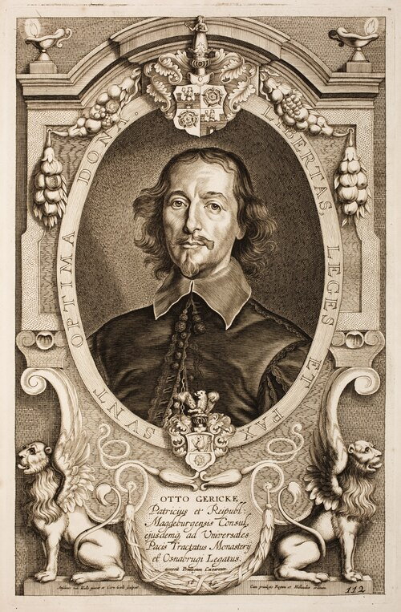

# Otto von Guericke

**Born:** 1602

**Died / status:** 1686

**Fields:** Vacuum physics, Gas physics, Electrostatics

The creator, date and form of this likeness are documented at the image source.

## Biography

Guericke was a German engineer, diplomat and mayor of Magdeburg who helped rebuild the city after the Thirty Years' War. He designed pumping apparatus and publicly demonstrated atmospheric pressure. His repeatable investigations of vacuum attracted attention across scientific Europe.

## Major contributions to physics

- Developed the vacuum pump and demonstrated atmospheric pressure with the Magdeburg hemispheres.
- Investigated phenomena in evacuated vessels and devices for generating static electricity, widening experimental natural philosophy.

## Historical and source notes

- Early dates can involve Julian/Gregorian differences; only confirmed years are retained here.

## Image source and rights

- Source: [Original image record](https://commons.wikimedia.org/wiki/File:Anselmus-van-Hulle-Hommes-illustres_MG_0539.tif)
- Creator / attribution: Anselm van Hulle / Cornelis Galle the Younger
- License or rights statement: Public domain
- Local image: [76d81c05590e0b1ab53b.jpg](../portraits/76d81c05590e0b1ab53b.jpg)
- Credit: Peace Palace Library

## Sources

- [Deutsche Biographie — Otto von Guericke](https://www.deutsche-biographie.de/gnd11854330X.html)
- [Wikipedia — Otto von Guericke](https://en.wikipedia.org/wiki/Otto_von_Guericke)

Record reviewed: 2026-10-26.
