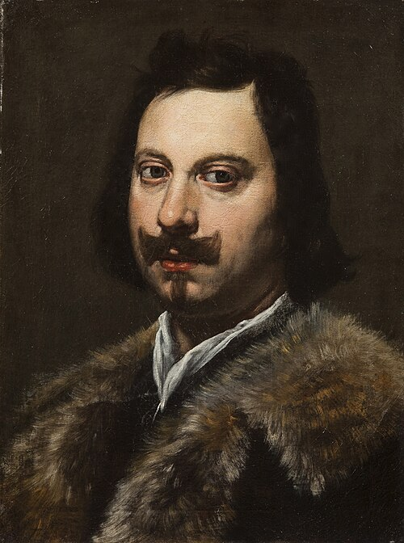

# Evangelista Torricelli

**Born:** 15 October 1608

**Died / status:** 25 October 1647

**Fields:** Fluid mechanics, Barometry, Vacuum physics

The creator, date and form of this likeness are documented at the image source.

## Biography

Torricelli was an Italian mathematician and physicist who studied with Castelli, assisted Galileo late in Galileo's life and succeeded him as Tuscan court mathematician. He investigated fluid flow, projectiles and geometry. His mercury-column experiment opened new approaches to atmospheric pressure and vacuum.

## Major contributions to physics

- Constructed the mercury barometer and interpreted its column as supported by atmospheric pressure.
- Established the relation between the speed of fluid outflow and the height of the liquid surface under suitable ideal conditions.

## Image source and rights

- Source: [Original image record](https://commons.wikimedia.org/wiki/File:Evangelista_Torricelli_by_Lorenzo_Lippi_(circa_1647,_Galleria_Silvano_Lodi_%26_Due).jpg)
- Creator / attribution: Lorenzo Lippi
- License or rights statement: Public domain
- Local image: [d914656a13ce62b51495.jpg](../portraits/d914656a13ce62b51495.jpg)
- Credit: http://www.tefaf.com/DesktopDefault.aspx?tabid=13&tabindex=12&highlightid=38037&categoryid=37

## Sources

- [MacTutor History of Mathematics — Evangelista Torricelli](https://mathshistory.st-andrews.ac.uk/Biographies/Torricelli/)
- [Wikipedia — Evangelista Torricelli](https://en.wikipedia.org/wiki/Evangelista_Torricelli)

Record reviewed: 2026-10-26.
