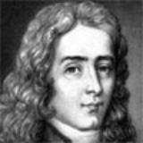

# Edme Mariotte

**Born:** c. 1620

**Died / status:** 12 or 21 May 1684

**Fields:** Gas physics, Fluid mechanics, Vision science

The creator, date and form of the image are documented at its source; later representations are not verified contemporary likenesses.

## Biography

Mariotte was a French experimental scientist and cleric and an early member of the Paris royal academy from 1666. He investigated air, liquids, collisions and vision through controlled experiments and quantitative relationships. His birth year is approximate, and his gas research developed independently of Boyle's.

## Major contributions to physics

- Independently investigated the approximate inverse pressure-volume relation for a fixed amount of gas at constant temperature.
- Investigated fluid motion and collisions and discovered the visual blind spot.

## Historical and source notes

- Birth is approximately 1620; sources give both 12 and 21 May 1684 for death, which must not be conflated.

## Image source and rights

- Source: [Original image record](https://commons.wikimedia.org/wiki/File:Edme_Mariotte.png)
- Creator / attribution: Unknown author
- License or rights statement: Public domain
- Local image: [e8a6940516ebabe0062c-47c0fc116c.png](../portraits/e8a6940516ebabe0062c-47c0fc116c.png)
- Credit: http://www.agracadaquimica.com.br/index.php?acao=quimica/qui/contribuintes

## Sources

- [Rice University Galileo Project — Edme Mariotte](https://galileo.library.rice.edu/Catalog/NewFiles/mariotte.html)
- [Wikipedia — Edme Mariotte](https://en.wikipedia.org/wiki/Edme_Mariotte)

Record reviewed: 2026-10-26.
