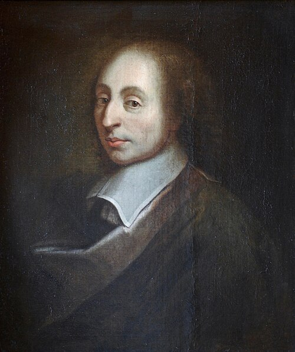

# Blaise Pascal

**Born:** 19 June 1623

**Died / status:** 19 August 1662

**Fields:** Hydrostatics, Gas physics

The creator, date and form of this likeness are documented at the image source.

## Biography

Pascal was a French mathematician, experimental investigator and philosopher who entered Parisian intellectual life early and designed a mechanical calculator. His experiments on vacuum and liquid columns advanced the study of atmospheric pressure and hydrostatics. Later he devoted more of his work to religion and philosophy.

## Major contributions to physics

- Formulated the transmission of applied pressure through a confined fluid, providing a basis for hydraulic devices.
- Organized comparisons of atmospheric pressure at different elevations, supporting the atmospheric-pressure explanation of mercury columns and challenging the claim that nature abhors a vacuum.

## Image source and rights

- Source: [Original image record](https://commons.wikimedia.org/wiki/File:Blaise_Pascal_Versailles,_circa_1690.JPG)
- Creator / attribution: unknown; a copy of the painting of François II Quesnel, which was made for Gérard Edelinck en 1691[réf. nécessaire].
- License or rights statement: Public domain
- Local image: [436536e2c8e13431b03f.jpg](../portraits/436536e2c8e13431b03f.jpg)
- Credit: Own work

## Sources

- [MacTutor History of Mathematics — Blaise Pascal](https://mathshistory.st-andrews.ac.uk/Biographies/Pascal/)
- [Wikipedia — Blaise Pascal](https://en.wikipedia.org/wiki/Blaise_Pascal)

Record reviewed: 2026-10-26.
