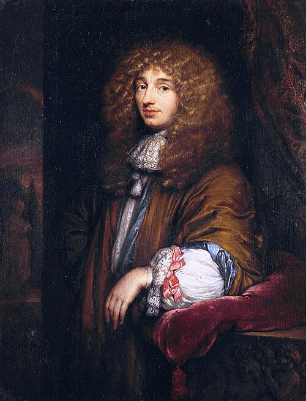

# Christiaan Huygens

**Born:** 14 April 1629

**Died / status:** 8 July 1695

**Fields:** Wave optics, Classical mechanics, Precision timekeeping

The creator, date and form of this likeness are documented at the image source.

## Biography

Huygens was a Dutch mathematician, physicist and astronomer who worked at the royal academy in Paris before returning to the Netherlands. Combining theoretical analysis with instrument making, he studied pendulum clocks, collisions, circular motion and light, linking the mechanics of Galileo's era to that of Newton.

## Major contributions to physics

- Proposed a wave account of light propagation and the construction now called Huygens' principle.
- Developed pendulum theory and pendulum clocks, improving precision timekeeping.
- Investigated elastic collisions and the relation for centrifugal effects in circular motion.

## Image source and rights

- Source: [Original image record](https://commons.wikimedia.org/wiki/File:Caspar_Netscher_-_Christiaan_Huygens,_the_astronomer,_1671.jpg)
- Creator / attribution: Caspar Netscher
- License or rights statement: Public domain
- Local image: [58b8bccdcd0f6ad8b2f4.jpg](../portraits/58b8bccdcd0f6ad8b2f4.jpg)
- Credit: http://ressources2.techno.free.fr/informatique/sites/inventions/inventions.html

## Sources

- [MacTutor History of Mathematics — Christiaan Huygens](https://mathshistory.st-andrews.ac.uk/Biographies/Huygens/)
- [Wikipedia — Christiaan Huygens](https://en.wikipedia.org/wiki/Christiaan_Huygens)

Record reviewed: 2026-10-26.
