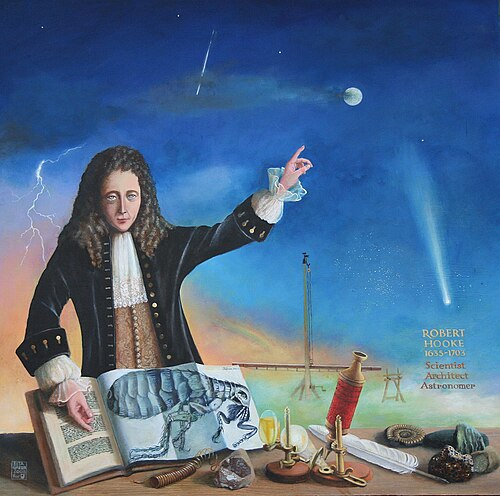

# Robert Hooke

**Born:** 18 July 1635 (Julian)

**Died / status:** 3 March 1703 (Julian)

**Fields:** Elasticity, Experimental physics, Optics

A modern commemorative portrait by Rita Greer, not a verified portrait made during Hooke’s lifetime.

## Biography

Hooke was an English experimental scientist, the Royal Society's long-serving Curator of Experiments and a lecturer at Gresham College. He designed instruments and studied elasticity, microscopy, astronomy and mechanisms. He also helped rebuild London after the Great Fire, exemplifying the breadth of seventeenth-century experimental science.

## Major contributions to physics

- Formulated proportionality between deformation and restoring force within the linear elastic range.
- Improved air pumps, microscopes and timekeeping devices, advancing experimental measurement.
- Contributed to discussions of gravitation, orbital motion and optics.

## Historical and source notes

- Life dates follow MacTutor in the Julian calendar: 18 July 1635 corresponds to 28 July Gregorian, and 3 March 1703 to 14 March Gregorian.
- No contemporary portrait of Hooke is universally accepted as securely identified; later paintings and memorial sculptures are not verified contemporary likenesses.

## Image source and rights

- Source: [Original image record](https://commons.wikimedia.org/wiki/File:15_Memorial_Portrait_at_The_Open_University.JPG)
- Creator / attribution: Rita Greer
- License or rights statement: [Free Art License](http://artlibre.org/licence/lal/en)
- Local image: [fff31797a33213f3d2e1-e128ac9a84.jpg](../portraits/fff31797a33213f3d2e1-e128ac9a84.jpg)
- Credit: The original is an oil painting on board by Rita Greer, history painter, 2009. This was digitized by Rita and sent via email to the Department of Engineering Science, Oxford University, where it was subsequently uploaded to Wikimedia.

## Sources

- [MacTutor History of Mathematics — Robert Hooke](https://mathshistory.st-andrews.ac.uk/Biographies/Hooke/)
- [Wikipedia — Robert Hooke](https://en.wikipedia.org/wiki/Robert_Hooke)

Record reviewed: 2026-10-26.
