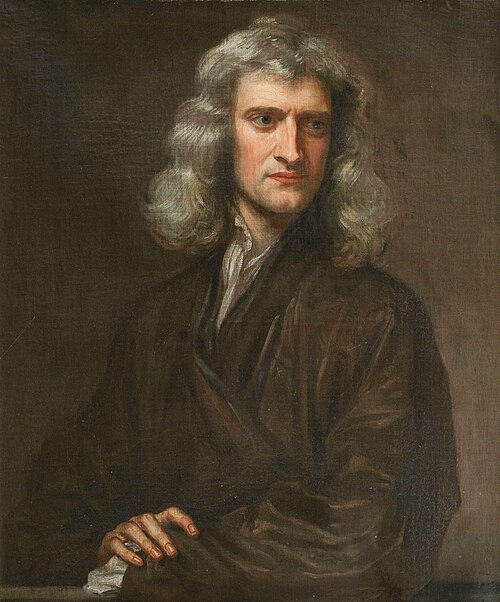

# Isaac Newton

**Born:** 4 January 1643

**Died / status:** 31 March 1727

**Fields:** Classical mechanics, Gravitation, Optics, Mathematical physics

The creator, date and form of this likeness are documented at the image source.

## Biography

Newton was an English mathematician and natural philosopher who held the Lucasian professorship at Cambridge, later directed the Royal Mint and served as president of the Royal Society. His Principia united mathematical descriptions of terrestrial and celestial motion. Prism experiments also transformed the study of light and colour.

## Major contributions to physics

- Formulated the laws of motion and universal gravitation, establishing classical mechanics.
- Showed that white light contains components of different colours and built a practical reflecting telescope.
- Independently developed calculus as a mathematical tool for continuous motion and gravitation.

## Historical and source notes

- Dates are Gregorian: 4 January 1643 and 31 March 1727, corresponding to 25 December 1642 and 20 March 1727 in the Julian calendar.

## Image source and rights

- Source: [Original image record](https://commons.wikimedia.org/wiki/File:Portrait_of_Sir_Isaac_Newton%2C_1689_%28brightened%29.jpg)
- Creator / attribution: Godfrey Kneller (1646–1723)
- License or rights statement: [Public domain](https://commons.wikimedia.org/wiki/Commons:Reuse_of_PD-Art_photographs)
- Local image: [ff8e6f222fb14327ae85.jpg](../portraits/ff8e6f222fb14327ae85.jpg)
- Credit: File:Portrait of Sir Isaac Newton, 1689.jpg from https://exhibitions.lib.cam.ac.uk/linesofthought/artifacts

## Sources

- [MacTutor History of Mathematics — Isaac Newton](https://mathshistory.st-andrews.ac.uk/Biographies/Newton/)
- [Wikipedia — Isaac Newton](https://en.wikipedia.org/wiki/Isaac_Newton)

Record reviewed: 2026-10-26.
