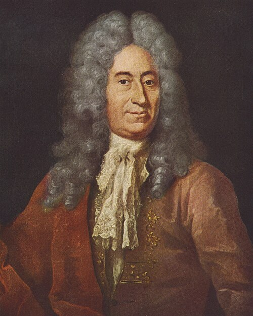

# Ole Rømer

**Born:** 25 September 1644

**Died / status:** 19 September 1710

**Fields:** Measurement of the speed of light, Astrometry, Physics instrumentation

The creator, date and form of this likeness are documented at the image source.

## Biography

Rømer was a Danish astronomer who worked at the Paris Observatory and later held a professorship in Copenhagen while undertaking civic responsibilities. Skilled in observation and instrument design, he used variations in the timing of eclipses of Io to investigate light propagation.

## Major contributions to physics

- Inferred that light has a finite speed from systematic variations in the observed timings of Io's eclipses.
- Improved meridian instruments and timekeeping, advancing precision astrometry.

## Image source and rights

- Source: [Original image record](https://commons.wikimedia.org/wiki/File:R%C3%B8mer%2C_Ole_%28ur_Ber%C3%B8mte_danske_maend%29.jpg)
- Creator / attribution: Jacob Coning
- License or rights statement: [Public domain](https://commons.wikimedia.org/wiki/Commons:Reuse_of_PD-Art_photographs)
- Local image: [0e239d8cc240470d90e1.jpg](../portraits/0e239d8cc240470d90e1.jpg)
- Credit: Farvereproduktioner efter 20 portrætter af berømte danske mænd (København 1943)

## Sources

- [American Museum of Natural History — Ole Roemer and the Speed of Light](https://www.amnh.org/learn-teach/curriculum-collections/cosmic-horizons-book/ole-roemer-speed-of-light)
- [Lex — Ole Rømer](https://lex.dk/Ole_R%C3%B8mer)
- [Wikipedia — Ole Rømer](https://en.wikipedia.org/wiki/Ole_R%C3%B8mer)

Record reviewed: 2026-10-26.
