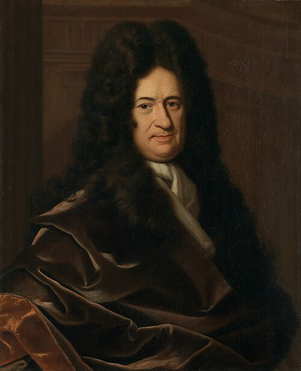

# Gottfried Wilhelm Leibniz

**Born:** 1 July 1646

**Died / status:** 14 November 1716

**Fields:** Mathematical physics, History of mechanics, History of the energy concept

The creator, date and form of this likeness are documented at the image source.

## Biography

Leibniz was a German mathematician, philosopher and diplomatic administrator who served the Hanoverian court and helped build European scholarly networks. He independently developed calculus and investigated collisions and measures of motion. His concept of vis viva formed part of the long development of ideas about energy.

## Major contributions to physics

- Developed calculus notation and methods that became general tools of theoretical physics.
- Investigated collisions and vis viva, using a quantity proportional to mass times speed squared to characterize mechanical motion.

## Image source and rights

- Source: [Original image record](https://commons.wikimedia.org/wiki/File:Christoph_Bernhard_Francke_-_Bildnis_des_Philosophen_Leibniz_(ca._1695).jpg)
- Creator / attribution: Christoph Bernhard Francke
- License or rights statement: Public domain
- Local image: [ad43c70af99f8fee9da5.jpg](../portraits/ad43c70af99f8fee9da5.jpg)
- Credit: Herzog Anton Ulrich-Museum, online

## Sources

- [MacTutor History of Mathematics — Gottfried Wilhelm Leibniz](https://mathshistory.st-andrews.ac.uk/Biographies/Leibniz/)
- [Wikipedia — Gottfried Wilhelm Leibniz](https://en.wikipedia.org/wiki/Gottfried_Wilhelm_Leibniz)

Record reviewed: 2026-10-26.
