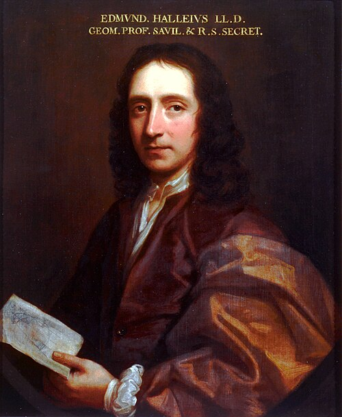

# Edmond Halley

**Born:** 8 November 1656

**Died / status:** 25 January 1742 (Gregorian)

**Fields:** Celestial mechanics, Geomagnetism, History of observational physics

The creator, date and form of this likeness are documented at the image source.

## Biography

Halley was an English astronomer and Royal Society fellow who became the second Astronomer Royal. He observed southern stars, investigated geomagnetism and the oceans and supported publication of Newton's Principia. His identification of a returning comet became a celebrated application of Newtonian theory to observation.

## Major contributions to physics

- Calculated cometary orbits and predicted the return of the comet subsequently named after him.
- Organized geomagnetic and marine observations and investigated the geographical distribution of magnetic declination.
- Supported and helped disseminate Newton's gravitational theory.

## Historical and source notes

- Birth is Gregorian 8 November 1656, corresponding to Julian 29 October. Death is Gregorian 25 January 1742, corresponding to Julian 14 January; the contemporary English legal year could also be written 1741.

## Image source and rights

- Source: [Original image record](https://commons.wikimedia.org/wiki/File:Edmund_Halley.jpg)
- Creator / attribution: Thomas Murray
- License or rights statement: Public domain
- Local image: [bf7bc97861c95dcf42f0.jpg](../portraits/bf7bc97861c95dcf42f0.jpg)
- Credit: https://commons.wikimedia.org/wiki/File:Edmund_Halley.gif

## Sources

- [MacTutor History of Mathematics — Edmond Halley](https://mathshistory.st-andrews.ac.uk/Biographies/Halley/)
- [Wikipedia — Edmond Halley](https://en.wikipedia.org/wiki/Edmond_Halley)
- [University of Bonn, History of Astronomy — Halley calendar note](https://unvis.it/astro.uni-bonn.de/~pbrosche/persons/pers_halley.html)
- [MacTutor, Heinz Klaus Strick — Edmond Halley](https://mathshistory.st-andrews.ac.uk/Strick/halley.pdf)

Record reviewed: 2026-10-26.
