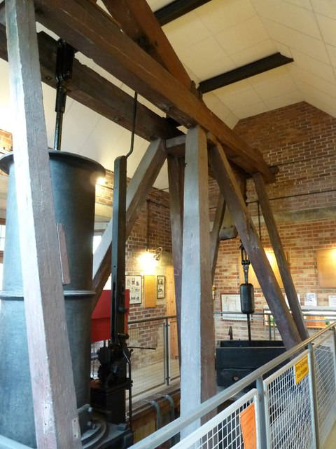

# Thomas Newcomen

**Born:** c. 1663–1664

**Died / status:** 5 August 1729

**Fields:** Heat-engine engineering, Pressure technology

No verified portrait was obtained. Chris Allen’s 2011 photograph shows the Newcomen-type engine displayed at Dartmouth. It is an instrument image, not a portrait or a claim to show the original 1712 engine.

## Biography

Newcomen was an ironmonger and inventor from Dartmouth who developed mine-pumping machinery with John Calley and other collaborators. Entering service around 1712, the Newcomen atmospheric engine used pressure differences produced by steam condensation to move a piston and became a major milestone in practical steam power.

## Major contributions to physics

- Developed a practical atmospheric steam engine for draining mines.
- Combined condensation, atmospheric pressure and mechanical transmission, providing a foundation for later steam-engine improvements.

## Historical and source notes

- Birth is approximately 1663–1664; 24 February 1664 is baptism, not an established exact birthday.

## Image source and rights

- Source: [Original image record](https://commons.wikimedia.org/wiki/File:Dartmouth_Newcomen_engine.jpg)
- Creator / attribution: Chris Allen / Geograph
- License or rights statement: [CC BY-SA 2.0; attribution: Chris Allen](https://creativecommons.org/licenses/by-sa/2.0/)
- Local image: [ace2083e34194d6507d8-4349e41935.jpg](../portraits/ace2083e34194d6507d8-4349e41935.jpg)
- Credit: Chris Allen / Geograph

## Sources

- [Science Museum — In pursuit of power](https://blog.sciencemuseum.org.uk/a-new-age/)
- [BBC History — Thomas Newcomen](https://www.bbc.co.uk/history/historic_figures/newcomen_thomas.shtml)
- [Wikipedia — Thomas Newcomen](https://en.wikipedia.org/wiki/Thomas_Newcomen)

Record reviewed: 2026-10-26.
