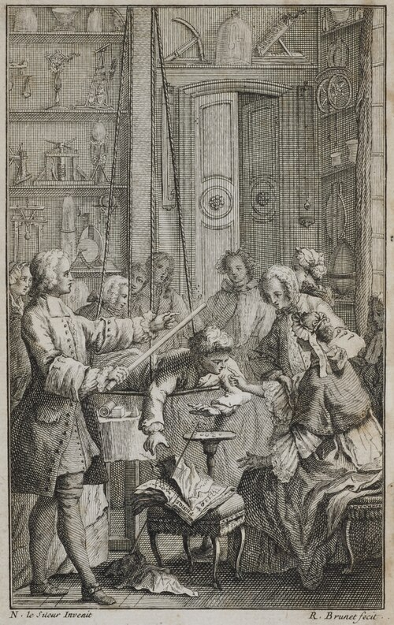

# Stephen Gray

**Born:** c. 1666

**Died / status:** February 1736; exact day disputed

**Fields:** Electrostatics, Electrical conduction

No verified portrait of Gray was obtained. This frontispiece from Nollet’s 1746 Essai sur l’électricité des corps shows Nollet’s version of the suspended electric-boy experiment associated with Gray’s conduction research. The figures must not be identified as Gray.

## Biography

Gray was an English dyer and amateur natural investigator from Canterbury who also made astronomical and microscopic observations. Late in life he systematically investigated conduction and insulation and became the first Copley Medal recipient. Some details of his life and exact death date remain uncertain.

## Major contributions to physics

- Demonstrated electrical transmission between separated objects using long connections and suspended bodies.
- Investigated how materials and supports affect conduction and charge retention, advancing distinctions between conductors and insulators.

## Historical and source notes

- 26 December 1666 is baptism; death is variously given as 7, 15 or 25 February, so only the month and explicit dispute are retained.

## Image source and rights

- Source: [Original image record](https://commons.wikimedia.org/wiki/File:RGNb10360943.01_Nollet_The_Electric_Boy.tif)
- Creator / attribution: Jean-Antoine Nollet / Science History Institute
- License or rights statement: [Public domain, as recorded by Wikimedia Commons](https://creativecommons.org/publicdomain/mark/1.0/)
- Local image: [c8f2bf9e829e5b64ba42-5622ff4def.jpg](../portraits/c8f2bf9e829e5b64ba42-5622ff4def.jpg)
- Credit: Jean-Antoine Nollet / Science History Institute

## Sources

- [Royal Society — Stephen Gray](https://makingscience.royalsociety.org/people/na7365/stephen-gray)
- [Kent Archaeological Society — New light on Stephen Gray](https://www.kentarchaeology.org.uk/journal/143/new-light-stephen-gray-frs-1666-1736-canterbury-freeman-dyer)
- [Wikipedia — Stephen Gray](https://en.wikipedia.org/wiki/Stephen_Gray_%28scientist%29)

Record reviewed: 2026-10-26.
