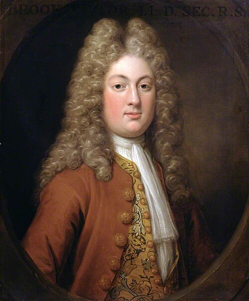

# Brook Taylor

**Born:** 18 August 1685

**Died / status:** 29 December 1731

**Fields:** Vibrations, Mathematical physics

The creator, date and form of the image are documented at its source; later representations are not verified contemporary likenesses.

## Biography

Taylor was an English mathematician educated at Cambridge who served as secretary of the Royal Society. He investigated series, perspective and mechanics and applied calculus to vibrating strings and motion. His expansion formula became a basic tool for approximation in physical theory.

## Major contributions to physics

- Investigated vibrating stretched strings and applied calculus to mechanics.
- Developed Taylor expansions and finite-difference methods, providing general tools for physical approximation and numerical analysis.

## Image source and rights

- Source: [Original image record](https://commons.wikimedia.org/wiki/File:Hans_Hysing_(1678-1753)_(attributed_to_studio_of)_-_Brook_Taylor_(1685%E2%80%931731)_-_RS.9685_-_Royal_Society.jpg)
- Creator / attribution: Hans Hysing
- License or rights statement: Public domain
- Local image: [544450613e229b278acc-a39670aea3.jpg](../portraits/544450613e229b278acc-a39670aea3.jpg)
- Credit: Art UK

## Sources

- [MacTutor History of Mathematics — Brook Taylor](https://mathshistory.st-andrews.ac.uk/Biographies/Taylor/)
- [Wikipedia — Brook Taylor](https://en.wikipedia.org/wiki/Brook_Taylor)

Record reviewed: 2026-10-26.
