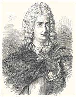

# Charles François de Cisternay du Fay

**Born:** 14 September 1698

**Died / status:** 16 July 1739

**Fields:** Electrostatics

A historical engraving of du Fay, attributed in the Commons record to Émile Thomas. The record’s century and creator information are inconsistent, so neither a creation date nor a contemporary sitting is asserted. It is presented as a later representation.

## Biography

Du Fay was a French scientist who served as an army officer before directing the royal garden in Paris and joining the academy. He repeated and extended electrical experiments by Gray and others. In 1733 he distinguished two electrical conditions through regularities of attraction and repulsion.

## Major contributions to physics

- Distinguished vitreous and resinous electricity, an important precursor to the later distinction between positive and negative charge.
- Investigated repulsion of like electrical states, attraction of unlike states and electrical transmission, systematizing electrostatic observations.

## Image source and rights

- Source: [Original image record](https://commons.wikimedia.org/wiki/File:Charles_Fran%C3%A7ois_de_Cisternay_du_Fay.jpg)
- Creator / attribution: Émile Thomas, as attributed in the source record
- License or rights statement: [Public domain, as recorded by Wikimedia Commons](https://creativecommons.org/publicdomain/mark/1.0/)
- Local image: [45ac56ea72af01456fd6-f482ac3239.jpg](../portraits/45ac56ea72af01456fd6-f482ac3239.jpg)
- Credit: Émile Thomas, as attributed in the source record

## Sources

- [Larousse — Charles François de Cisternay Du Fay](https://www.larousse.fr/encyclopedie/personnage/Charles_François_de_Cisternay_Du_Fay/117257)
- [SPARK Museum — Two kinds of electrical fluid: Vitreous and Resinous](http://www.sparkmuseum.com/BOOK_DUFAY.HTM)
- [Wikipedia — Charles François de Cisternay du Fay](https://en.wikipedia.org/wiki/Charles_Fran%C3%A7ois_de_Cisternay_du_Fay)

Record reviewed: 2026-10-26.
