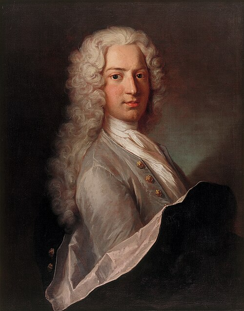

# Daniel Bernoulli

**Born:** 8 February 1700

**Died / status:** 17 March 1782

**Fields:** Fluid mechanics, Kinetic theory of gases, Vibrations

The creator, date and form of this likeness are documented at the image source.

## Biography

Daniel Bernoulli belonged to the Swiss mathematical family. Initially trained in medicine, he worked at the St Petersburg Academy before teaching for many years in Basel. He applied mechanical reasoning to fluids, vibrations and physiological problems; his Hydrodynamica of 1738 is a landmark of mathematical physics.

## Major contributions to physics

- Developed the relation between pressure, speed and elevation for ideal fluid flow.
- Explained gas pressure through particle motion, becoming an early contributor to kinetic theory.
- Investigated vibrating strings and the modes of mechanical systems.

## Image source and rights

- Source: [Original image record](https://commons.wikimedia.org/wiki/File:Portr%C3%A4t_des_Daniel_Bernoulli_-_edit1.jpg)
- Creator / attribution: UnknownEdited by Bammesk
- License or rights statement: [CC BY-SA 4.0](https://commons.wikimedia.org/wiki/File:Portr%C3%A4t_des_Daniel_Bernoulli_-_edit1.jpg)
- Local image: [3939bfc4fb48bf01be35.jpg](../portraits/3939bfc4fb48bf01be35.jpg)
- Credit: Basel Historical Museum Link: https://www.hmb.ch/en/museums/objects-in-the-collection/details/s/portraet-des-daniel-bernoulli/

## Sources

- [MacTutor History of Mathematics — Daniel Bernoulli](https://mathshistory.st-andrews.ac.uk/Biographies/Bernoulli_Daniel/)
- [Wikipedia — Daniel Bernoulli](https://en.wikipedia.org/wiki/Daniel_Bernoulli)

Record reviewed: 2026-10-26.
