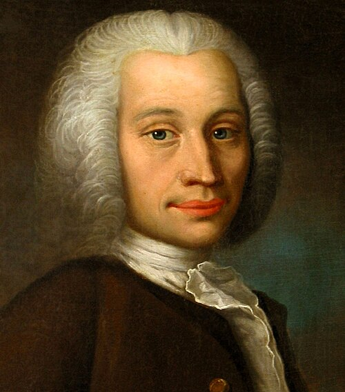

# Anders Celsius

**Born:** 27 November 1701

**Died / status:** 25 April 1744

**Fields:** Thermometry, Geophysics, Astronomical measurement

The creator, date and form of this likeness are documented at the image source.

## Biography

Celsius was a Swedish astronomer and professor at Uppsala who established an observatory and joined the Lapland meridian expedition. He studied Earth's figure, aurorae and thermometry. His scale divided the interval between water's phase-change points into one hundred parts, with the opposite direction to today's familiar scale.

## Major contributions to physics

- Proposed a hundred-degree temperature scale between water's freezing and boiling points.
- Participated in meridian-arc measurements testing Earth's figure and in observations of aurorae and geomagnetism.

## Historical and source notes

- Birth follows Uppsala University: 27 November 1701. MacTutor quick information instead gives 11 November.
- The original scale of 1742 placed zero at boiling and one hundred at freezing; the familiar direction was introduced later.

## Image source and rights

- Source: [Original image record](https://commons.wikimedia.org/wiki/File:Headshot_of_Anders_Celsius.jpg)
- Creator / attribution: Olof Arenius
- License or rights statement: Public domain
- Local image: [40b432cec07fdee61cf7.jpg](../portraits/40b432cec07fdee61cf7.jpg)
- Credit: https://richardnilsendotcom1.files.wordpress.com/2013/03/anders_celsius.jpg as thumbnailed by https://richardnilsen.com/2013/03/18/the-measure-of-humankind/

## Sources

- [MacTutor History of Mathematics — Anders Celsius](https://mathshistory.st-andrews.ac.uk/Biographies/Celsius/)
- [Uppsala University — Anders Celsius biography](https://www.astro.uu.se/history/celsius.pdf)
- [Wikipedia — Anders Celsius](https://en.wikipedia.org/wiki/Anders_Celsius)

Record reviewed: 2026-10-26.
