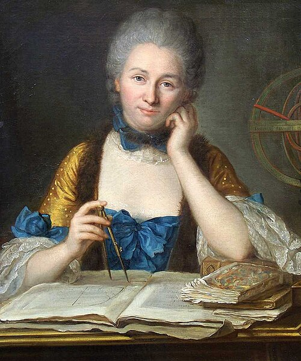

# Émilie du Châtelet

**Born:** 17 December 1706

**Died / status:** 10 September 1749

**Fields:** Classical mechanics, History of the energy concept, Science communication

The creator, date and form of this likeness are documented at the image source.

## Biography

Du Châtelet was a French Enlightenment scholar who studied mathematics and natural philosophy through private tuition and scholarly exchange in a setting that restricted women's formal education. She wrote the Institutions de physique and translated and annotated Newton's Principia, bringing advanced mechanics into French intellectual life. She died shortly after completing that translation.

## Major contributions to physics

- Combined and critically discussed Newtonian, Leibnizian and other approaches to mechanics in the Institutions de physique.
- Translated and extensively annotated the Principia, advancing the transmission of classical mechanics.
- Participated in debates on vis viva and the significance of speed squared in measures of mechanical effects.

## Image source and rights

- Source: [Original image record](https://commons.wikimedia.org/wiki/File:Emilie_Chatelet_portrait_by_Latour.jpg)
- Creator / attribution: Maurice Quentin de La Tour
- License or rights statement: Public domain
- Local image: [43fb0ef572198cf3d7d3.jpg](../portraits/43fb0ef572198cf3d7d3.jpg)
- Credit: http://enlenguapropia.files.wordpress.com/2013/06/emilie_chatelet.jpg via https://gallica.bnf.fr/essentiels/du-chatelet http://classes.bnf.fr/pdf/Chatelet.pdf https://web.archive.org/web/20211016012211/http://classes.bnf.fr/pdf/Chatelet.pdf

## Sources

- [MacTutor History of Mathematics — Émilie du Châtelet](https://mathshistory.st-andrews.ac.uk/Biographies/Chatelet/)
- [Wikipedia — Émilie du Châtelet](https://en.wikipedia.org/wiki/%C3%89milie_du_Ch%C3%A2telet)

Record reviewed: 2026-10-26.
