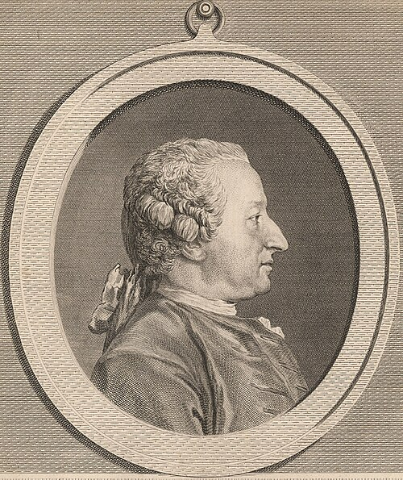

# Alexis Clairaut

**Born:** 13 May 1713

**Died / status:** 17 May 1765

**Fields:** Celestial mechanics, Geophysics

The creator, date and form of the image are documented at its source; later representations are not verified contemporary likenesses.

## Biography

Clairaut was a French mathematician and astronomer admitted to the academy while young who joined Maupertuis's Lapland expedition. He applied differential equations to Earth's figure, lunar motion and cometary orbits and advised du Châtelet on Newtonian mechanics, becoming a major eighteenth-century mathematical physicist.

## Major contributions to physics

- Developed Clairaut's theory connecting Earth's figure, gravity and rotation.
- Improved lunar perturbation calculations and worked with collaborators on predicting the return of Halley's comet.

## Historical and source notes

- Birth follows the French Academy of Sciences tercentenary material: 13 May 1713; MacTutor and some older sources give 7 May.

## Image source and rights

- Source: [Original image record](https://commons.wikimedia.org/wiki/File:Alexis_Clairault.jpg)
- Creator / attribution: Louis-Jacques Cathelin / After Charles-Nicolas Cochin
- License or rights statement: Public domain
- Local image: [c95153d83c190371f850-46b5d58f9f.jpg](../portraits/c95153d83c190371f850-46b5d58f9f.jpg)
- Credit: SIL-SIL14-C4-01 [1], image [2]

## Sources

- [MacTutor History of Mathematics — Alexis Clairaut](https://mathshistory.st-andrews.ac.uk/Biographies/Clairaut/)
- [French Academy of Sciences — Clairaut tercentenary programme, 2013](https://www.academie-sciences.fr/pdf/conf/colloque_130513.pdf)
- [Wikipedia — Alexis Clairaut](https://en.wikipedia.org/wiki/Alexis_Clairaut)

Record reviewed: 2026-10-26.
