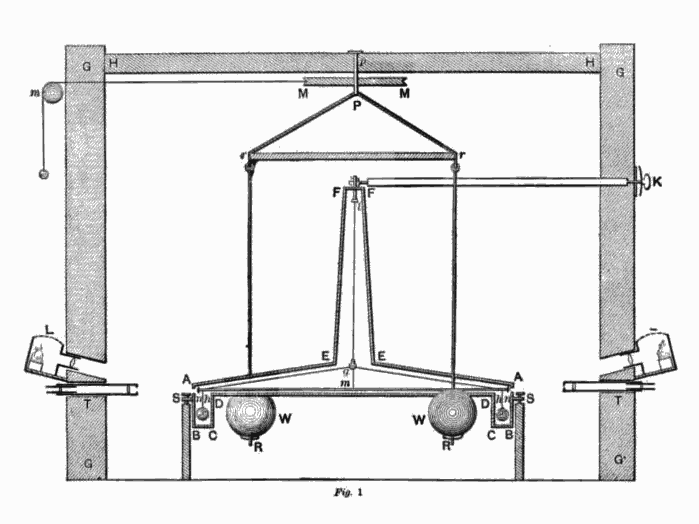

# John Michell

**Born:** 25 December 1724

**Died / status:** 21 April 1793

**Fields:** Gravitational experiments, History of astrophysics, Geophysics

No verified portrait of Michell was obtained. This diagram comes from Cavendish’s 1798 paper on the density of the Earth. Michell originated the torsion-balance method and apparatus, but the drawing shows Cavendish’s apparatus, not Michell’s appearance.

## Biography

Michell was an English clergyman and natural investigator who taught at Cambridge before serving a parish in Yorkshire. He studied magnetism, earthquakes, stars and gravitation and designed a torsion-balance experiment to determine Earth's density. Cavendish later used the apparatus in his celebrated experiment.

## Major contributions to physics

- Designed torsion-balance apparatus for measuring weak gravitational attraction and Earth's density.
- Discussed dark stars from which light could not escape within Newtonian gravitation and corpuscular optics, and investigated statistical evidence for stellar pairs.

## Historical and source notes

- His dark stars were based on Newtonian gravity and corpuscular light, not the general-relativistic theory of black holes.
- No securely authenticated contemporary likeness was obtained; later representations or contextual documents must be identified as such.

## Image source and rights

- Source: [Original image record](https://commons.wikimedia.org/wiki/File:Cavendish_Experiment.png)
- Creator / attribution: Henry Cavendish (1798 diagram)
- License or rights statement: [Public domain, as recorded by Wikimedia Commons](https://creativecommons.org/publicdomain/mark/1.0/)
- Local image: [e682c2c9183b9a4ea469-2b585751a6.png](../portraits/e682c2c9183b9a4ea469-2b585751a6.png)
- Credit: Henry Cavendish (1798 diagram)

## Sources

- [Royal Society — John Michell](https://makingscience.royalsociety.org/people/na7798/john-michell)
- [Queens’ College Cambridge History Archive — John Michell](https://history.queens.cam.ac.uk/individuals-interest/john-michell)
- [Wikipedia — John Michell](https://en.wikipedia.org/wiki/John_Michell)

Record reviewed: 2026-10-26.
