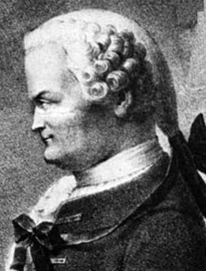

# Johann Heinrich Lambert

**Born:** 26 August 1728

**Died / status:** 25 September 1777

**Fields:** Photometry, Thermal physics, Astronomy

The creator, date and form of the image are documented at its source; later representations are not verified contemporary likenesses.

## Biography

Lambert was a mathematician, physicist and astronomer born in Mulhouse who was largely self-educated and later joined the Berlin academy. He investigated light intensity, reflection, heat and celestial systems. His Photometria of 1760 systematically quantified brightness and illumination.

## Major contributions to physics

- Developed quantitative photometry and investigated illumination, absorption and diffuse reflection.
- Investigated heat conduction, astronomical distances and cosmic structure through measurement and mathematical models.

## Image source and rights

- Source: [Original image record](https://commons.wikimedia.org/wiki/File:JHLambert.jpg)
- Creator / attribution: See the original image record
- License or rights statement: Public domain
- Local image: [d44980cd8abefcefb8a3-011e7421a5.jpg](../portraits/d44980cd8abefcefb8a3-011e7421a5.jpg)

## Sources

- [MacTutor History of Mathematics — Johann Heinrich Lambert](https://mathshistory.st-andrews.ac.uk/Biographies/Lambert/)
- [Wikipedia — Johann Heinrich Lambert](https://en.wikipedia.org/wiki/Johann_Heinrich_Lambert)

Record reviewed: 2026-10-26.
