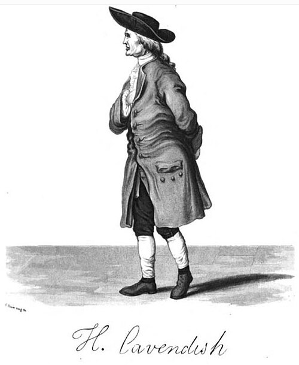

# Henry Cavendish

**Born:** 10 October 1731

**Died / status:** 24 February 1810

**Fields:** Gravitational experiments, Electrostatics, Gas physics

The creator, date and form of this likeness are documented at the image source.

## Biography

Cavendish was a British experimental scientist from an aristocratic family who investigated gases, electricity and heat, mainly in private laboratories in London. He became known for exceptionally careful quantitative measurements. He published comparatively little, and some of his electrical research was edited only long after his death.

## Major contributions to physics

- Used a torsion balance to measure weak gravitational attraction and determine Earth's mean density.
- Investigated gases, the composition of water and quantitative electrical relationships, advancing high-precision experimental methods.

## Image source and rights

- Source: [Original image record](https://commons.wikimedia.org/wiki/File:Cavendish_Henry_signature.jpg)
- Creator / attribution: George Wilson
- License or rights statement: Public domain
- Local image: [6058f9ffd1b966d450e8.jpg](../portraits/6058f9ffd1b966d450e8.jpg)
- Credit: Frontispiece of The Life of the Hon. Henry Cavendish

## Sources

- [Royal Society — Henry Cavendish](https://makingscience.royalsociety.org/people/na8163/henry-cavendish)
- [Royal College of Physicians of Edinburgh — Henry Cavendish](https://www.rcpe.ac.uk/peoplesdispensary/browse/individualpractitioner/dr_henry_cavendish.html)
- [Wikipedia — Henry Cavendish](https://en.wikipedia.org/wiki/Henry_Cavendish)
- [Royal Society — Henry Cavendish current catalogue](https://catalogues.royalsociety.org/CalmView/Record.aspx?id=NA8163&src=CalmView.Persons)

Record reviewed: 2026-10-26.
