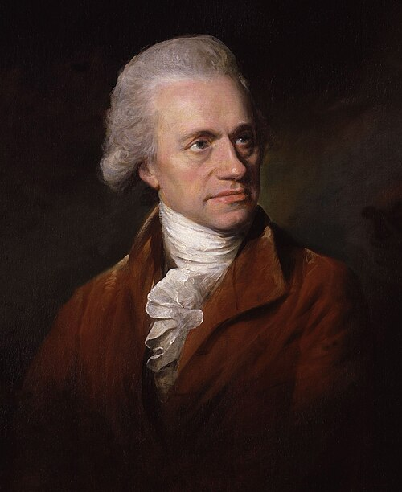

# William Herschel

**Born:** 15 November 1738

**Died / status:** 25 August 1822

**Fields:** Radiation physics, Astronomy, Optical instruments

The creator, date and form of this likeness are documented at the image source.

## Biography

Herschel was a Hanover-born British astronomer and musician who gradually turned from music to astronomy after moving to Britain. Working with his sister Caroline, he built telescopes and surveyed the sky. Discovering heat beyond the visible solar spectrum extended the study of radiation beyond visible light.

## Major contributions to physics

- Discovered infrared radiation in experiments on the heating effects of sunlight beyond the visible red.
- Discovered Uranus and systematically investigated stars, double stars and nebulae, advancing stellar astronomy.

## Image source and rights

- Source: [Original image record](https://commons.wikimedia.org/wiki/File:William_Herschel01.jpg)
- Creator / attribution: Lemuel Francis Abbott
- License or rights statement: Public domain
- Local image: [a2ec1d602fe37bc2d0ca.jpg](../portraits/a2ec1d602fe37bc2d0ca.jpg)
- Credit: one or more third parties have made copyright claims against Wikimedia Commons in relation to the work from which this is sourced or a purely mechanical reproduction thereof. This may be due to recognition of the "sweat of the brow" doctrine, allowing works to be eligible for protection through skill and labour, and not purely by originality as is the case in the United States (where this website is hosted). These claims may or may not be valid in all jurisdictions. As such, use of this image in the jurisdiction of the claimant or other countries may be regarded as copyright infringement. Please see Commons:When to use the PD-Art tag for more information.

## Sources

- [MacTutor History of Mathematics — William Herschel](https://mathshistory.st-andrews.ac.uk/Biographies/Herschel_William/)
- [Wikipedia — William Herschel](https://en.wikipedia.org/wiki/William_Herschel)

Record reviewed: 2026-10-26.
