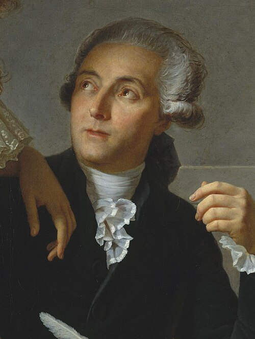

# Antoine Lavoisier

**Born:** 26 August 1743

**Died / status:** 8 May 1794

**Fields:** Calorimetry, Conservation of matter, Physical chemistry

The creator, date and form of this likeness are documented at the image source.

## Biography

Lavoisier was a French chemist, financial administrator and experimental investigator associated with the Paris Academy. He emphasized precise weighing and worked with Laplace on calorimetry and respiration, connecting material transformations to heat. During the French Revolution he was executed because of his role in tax administration.

## Major contributions to physics

- Established quantitative evidence for conservation of mass in chemical reactions, helping make the study of matter a measurement-based science.
- Developed an ice calorimeter with Laplace and investigated the heat of chemical reactions and respiration.

## Image source and rights

- Source: [Original image record](https://commons.wikimedia.org/wiki/File:David_-_Portrait_of_Monsieur_Lavoisier_(cropped)2.jpg)
- Creator / attribution: Jacques-Louis David
- License or rights statement: Public domain
- Local image: [a31df7fd8b9584b36106.jpg](../portraits/a31df7fd8b9584b36106.jpg)
- Credit: Metropolitan Museum of Art: entry 436106 (accession number: 1977.10)

## Sources

- [American Philosophical Society — Antoine Lavoisier](https://search.amphilsoc.org/memhist/search?creator=Antoine+lavoisier)
- [Wikipedia — Antoine Lavoisier](https://en.wikipedia.org/wiki/Antoine_Lavoisier)

Record reviewed: 2026-10-26.
