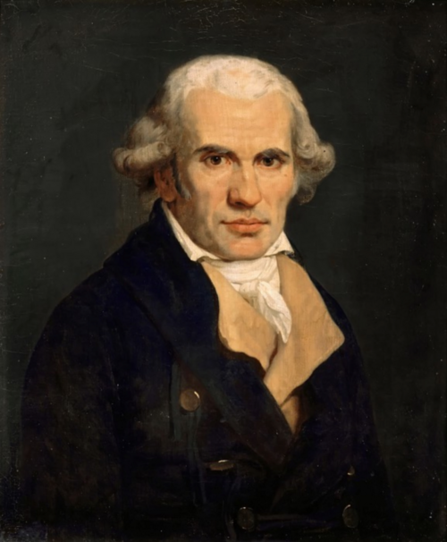

# Gaspard Monge

**Born:** 9 May 1746

**Died / status:** 28 July 1818

**Fields:** Mathematical physics, Engineering geometry

The creator, date and form of the image are documented at its source; later representations are not verified contemporary likenesses.

## Biography

Monge was a French mathematician, organizer of engineering education and public figure who worked at Mézières and in Paris and helped establish the École Polytechnique. He investigated surfaces, geometry and differential equations and connected mathematics to mechanical construction and engineering training.

## Major contributions to physics

- Established descriptive geometry as a systematic method of representing spatial constructions and engineering designs.
- Investigated surfaces and partial differential equations, supplying methods relevant to geometrical optics, continua and mathematical physics.

## Image source and rights

- Source: [Original image record](https://commons.wikimedia.org/wiki/File:Jean-Baptiste_Mauzaisse_%E2%80%93_Gaspard_Monge,_Comte_de_Peluse_(1746-1818)_Ch%C3%A2teau_de_Versailles.png)
- Creator / attribution: Мурад Зиналиев
- License or rights statement: [CC BY-SA 4.0](https://creativecommons.org/licenses/by-sa/4.0)
- Local image: [4e21254e45213a6a9965-cd982a2334.png](../portraits/4e21254e45213a6a9965-cd982a2334.png)
- Credit: Own work

## Sources

- [MacTutor History of Mathematics — Gaspard Monge](https://mathshistory.st-andrews.ac.uk/Biographies/Monge/)
- [Wikipedia — Gaspard Monge](https://en.wikipedia.org/wiki/Gaspard_Monge)

Record reviewed: 2026-10-26.
