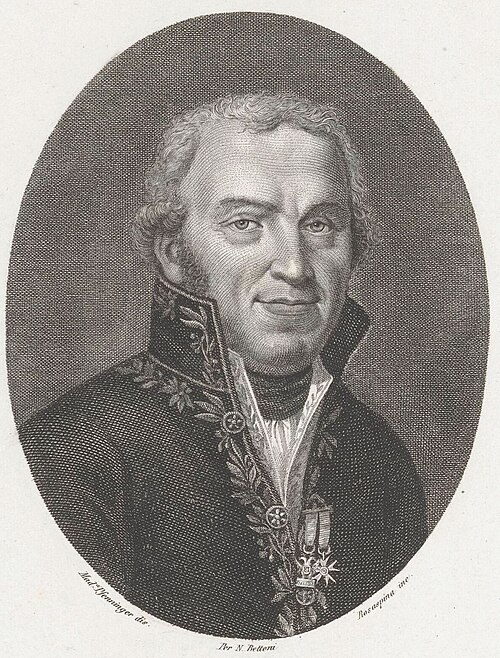

# Giovanni Battista Venturi

**Born:** 11 September 1746

**Died / status:** 10 September 1822

**Fields:** Fluid mechanics, Experimental physics

The creator, date and form of the image are documented at its source; later representations are not verified contemporary likenesses.

## Biography

Venturi was an Italian cleric, physicist and diplomat who taught in Modena and Pavia. He investigated fluids, electricity and magnetism and the history of science and published experimental work on flowing liquids in Paris. The effect bearing his name later became important in flow measurement.

## Major contributions to physics

- Investigated changes of speed and pressure as a fluid passes through a constriction, known as the Venturi effect.
- Connected fluid experiments to hydraulic engineering, providing physical foundations for later Venturi flowmeters.

## Image source and rights

- Source: [Original image record](https://commons.wikimedia.org/wiki/File:Portret_van_natuurkundige_Giovanni_Battista_Venturi,_RP-P-1909-5266_(cropped).jpg)
- Creator / attribution: Rijksmuseum
- License or rights statement: [CC0](http://creativecommons.org/publicdomain/zero/1.0/deed.en)
- Local image: [9e9aaeb1191b6aba51e4-bd4a37216c.jpg](../portraits/9e9aaeb1191b6aba51e4-bd4a37216c.jpg)
- Credit: http://hdl.handle.net/10934/RM0001.COLLECT.167127

## Sources

- [Treccani, Dizionario Biografico — Giovanni Battista Venturi](https://www.treccani.it/enciclopedia/giovanni-battista-venturi_(Dizionario-Biografico))
- [Wikipedia — Giovanni Battista Venturi](https://en.wikipedia.org/wiki/Giovanni_Battista_Venturi)

Record reviewed: 2026-10-26.
