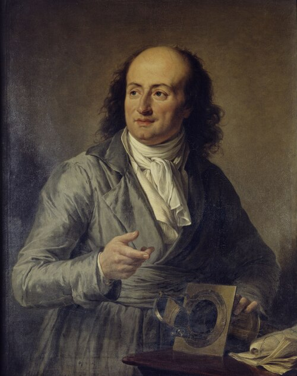

# Jacques Charles

**Born:** 12 November 1746

**Died / status:** 7 or 8 April 1823

**Fields:** Gas physics, Experimental instruments

The creator, date and form of the image are documented at its source; later representations are not verified contemporary likenesses.

## Biography

Charles was a French experimental investigator, collector of instruments and balloon pioneer who lectured on physics in Paris. With the Robert brothers he developed hydrogen balloons. His observations on gas expansion were later communicated by Gay-Lussac and others and became associated with the gas law bearing his name.

## Major contributions to physics

- Investigated how gas volume changes with temperature at constant pressure.
- Helped build and fly early manned hydrogen balloons, connecting knowledge of gases to aeronautical experiments.

## Historical and source notes

- Sources differ between 7 and 8 April 1823 for death; his gas experiments were communicated principally through later writings by Gay-Lussac.

## Image source and rights

- Source: [Original image record](https://commons.wikimedia.org/wiki/File:Portrait_du_physicien_Charles_(cropped).jpg)
- Creator / attribution: Adélaïde Labille-Guiard
- License or rights statement: Public domain
- Local image: [b00f267f10d698dd9ddd-ccff406336.jpg](../portraits/b00f267f10d698dd9ddd-ccff406336.jpg)
- Credit: https://art.rmngp.fr/en/library/artworks/adelaide-labille-guiard_portrait-du-physicien-charles

## Sources

- [Musée des Arts et Métiers — Animorphose, Charles’s physics cabinet](https://www.arts-et-metiers.net/musee/animorphose)
- [Le Moyne College — Gay-Lussac’s 1802 paper, including Charles’s earlier experiments](https://web.lemoyne.edu/~giunta/gaygas.html)
- [Wikipedia — Jacques Charles](https://en.wikipedia.org/wiki/Jacques_Charles)

Record reviewed: 2026-10-26.
