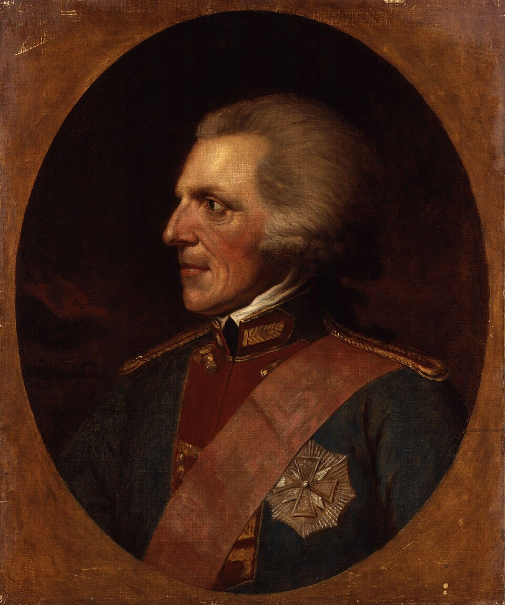

# Benjamin Thompson

**Born:** 26 March 1753

**Died / status:** 21 August 1814

**Fields:** Thermal physics, History of the energy concept, Heat transfer

The creator, date and form of this likeness are documented at the image source.

## Biography

Thompson, later Count Rumford, was a North American-born scientist, soldier and administrator who served Britain and Bavaria. He studied heating, stoves and military equipment and helped found London's Royal Institution. Experiments on heat generated during cannon boring challenged caloric accounts of heat.

## Major contributions to physics

- Used continuing heat generation by mechanical friction to argue for a connection between heat and motion.
- Studied heat transfer and improved stoves and heating systems, applying thermal investigation to public welfare.

## Image source and rights

- Source: [Original image record](https://commons.wikimedia.org/wiki/File:Sir_Benjamin_Thompson%2C_Count_von_Rumford_by_Moritz_Kellerhoven.jpg)
- Creator / attribution: After Moritz Kellerhoven (1758–1830)
- License or rights statement: [Public domain](https://commons.wikimedia.org/wiki/Commons:Reuse_of_PD-Art_photographs)
- Local image: [fc38fc0d16b2d6117796.jpg](../portraits/fc38fc0d16b2d6117796.jpg)
- Credit: National Portrait Gallery: NPG 1332

## Sources

- [National Portrait Gallery — Count Rumford](https://www.npg.org.uk/collections/search/person/mp03895/sir-benjamin-thompson-count-von-rumford)
- [Monticello — Count Rumford](https://www.monticello.org/encyclopedia/sir-benjamin-thompson-count-von-rumford)
- [Wikipedia — Benjamin Thompson](https://en.wikipedia.org/wiki/Benjamin_Thompson)

Record reviewed: 2026-10-26.
