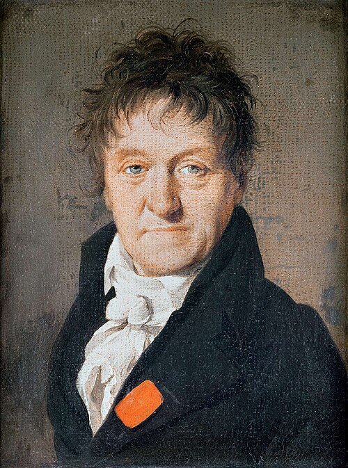

# Lazare Carnot

**Born:** 13 May 1753

**Died / status:** 2 August 1823

**Fields:** Engineering mechanics, Analytical mechanics

The creator, date and form of the image are documented at its source; later representations are not verified contemporary likenesses.

## Biography

Lazare Carnot was a French military engineer, political figure and mathematician, and the father of Sadi Carnot. Alongside military and public responsibilities he investigated machines, collisions and geometry. His treatment of losses and transformations in mechanical motion was an important antecedent of later engine and energy theories.

## Major contributions to physics

- Investigated losses of mechanical effect in collisions and machines.
- Analyzed machines through general geometrical and mechanical methods, contributing to engineering mechanics and the historical development of energy concepts.

## Image source and rights

- Source: [Original image record](https://commons.wikimedia.org/wiki/File:Lazare-Carnot-par-Boilly.jpg)
- Creator / attribution: Louis-Léopold Boilly
- License or rights statement: Public domain
- Local image: [9122cf6a2d29ba65e72a-b9154ccc13.jpg](../portraits/9122cf6a2d29ba65e72a-b9154ccc13.jpg)
- Credit: http://shows.we-envision.com/aa/2big/BOILLY,%20Louis%20L%C3%A9opold/BOILLY,%20Louis%20L%C3%A9opold.html

## Sources

- [MacTutor History of Mathematics — Lazare Carnot](https://mathshistory.st-andrews.ac.uk/Biographies/Carnot/)
- [Wikipedia — Lazare Carnot](https://en.wikipedia.org/wiki/Lazare_Carnot)

Record reviewed: 2026-10-26.
