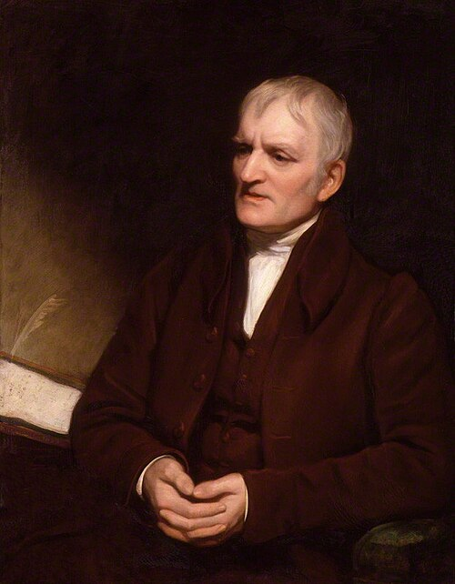

# John Dalton

**Born:** 5 or 6 September 1766 (sources differ)

**Died / status:** 27 July 1844

**Fields:** Atomic theory, Gas physics, Vision science

The creator, date and form of this likeness are documented at the image source.

## Biography

Dalton was an English chemist, physicist and weather observer from a Quaker family in Cumberland who later taught and researched in Manchester. Long-term meteorological records and gas studies informed his quantitative atomic theory. His investigation of his own colour vision also became historically influential.

## Major contributions to physics

- Developed modern chemical atomic theory by relating composition to the relative masses of atoms.
- Formulated the law of partial pressures and investigated gases and vapours.
- Systematically studied colour-vision deficiency, contributing to scientific investigation of vision.

## Historical and source notes

- Sources differ between 5 and 6 September; the Science Museum gives approximately 6 September.

## Image source and rights

- Source: [Original image record](https://commons.wikimedia.org/wiki/File:John_Dalton_by_Thomas_Phillips%2C_1835.jpg)
- Creator / attribution: Thomas Phillips (1770–1845)
- License or rights statement: [Public domain](https://commons.wikimedia.org/wiki/Commons:Reuse_of_PD-Art_photographs)
- Local image: [138cbd1cc0ec3d537197.jpg](../portraits/138cbd1cc0ec3d537197.jpg)
- Credit: National Portrait Gallery, London

## Sources

- [Royal Society — John Dalton](https://royalsociety.org/about-us/who-we-are/diversity-inclusion/case-studies/scientists-with-disabilities/john-dalton/)
- [Science Museum — Celebrating John Dalton](https://blog.sciencemuseum.org.uk/celebrating-john-dalton/)
- [Wikipedia — John Dalton](https://en.wikipedia.org/wiki/John_Dalton)

Record reviewed: 2026-10-26.
