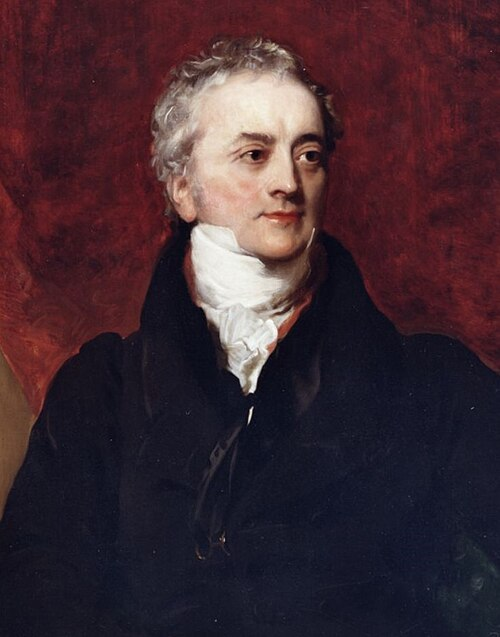

# Thomas Young

**Born:** 13 June 1773

**Died / status:** 10 May 1829

**Fields:** Wave optics, Elasticity, Vision science

The creator, date and form of this likeness are documented at the image source.

## Biography

Young was an English physician, physicist and linguist who studied in Edinburgh and Göttingen and lectured at the Royal Institution. He linked medicine and vision to optics and also investigated elasticity and ancient Egyptian writing. He was a central figure in the early nineteenth-century revival of wave optics.

## Major contributions to physics

- Used interference and double-slit-related experiments to support the wave nature of light.
- Investigated elasticity and helped establish the use of Young's modulus to describe tensile stiffness.
- Proposed a trichromatic account of colour vision, connecting optics to visual physiology.

## Image source and rights

- Source: [Original image record](https://commons.wikimedia.org/wiki/File:Thomas_Young_by_Briggs_cropped.jpg)
- Creator / attribution: Henry Perronet Briggs
- License or rights statement: [CC BY-SA 4.0](https://creativecommons.org/licenses/by-sa/4.0)
- Local image: [017ade19319a5a04dbbe.jpg](../portraits/017ade19319a5a04dbbe.jpg)
- Credit: http://rstb.royalsocietypublishing.org/content/370/1666/20140308

## Sources

- [MacTutor History of Mathematics — Thomas Young](https://mathshistory.st-andrews.ac.uk/Biographies/Young_Thomas/)
- [Wikipedia — Thomas Young (scientist)](https://en.wikipedia.org/wiki/Thomas_Young_(scientist))

Record reviewed: 2026-10-26.
